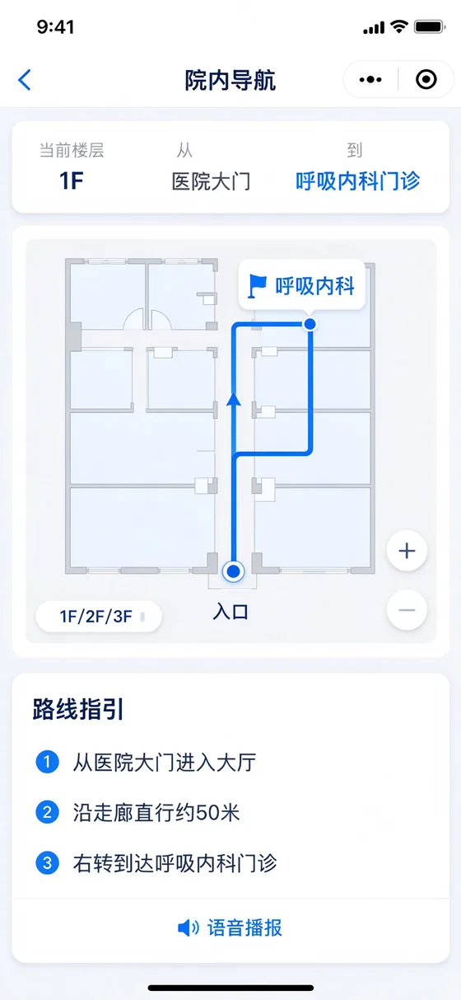
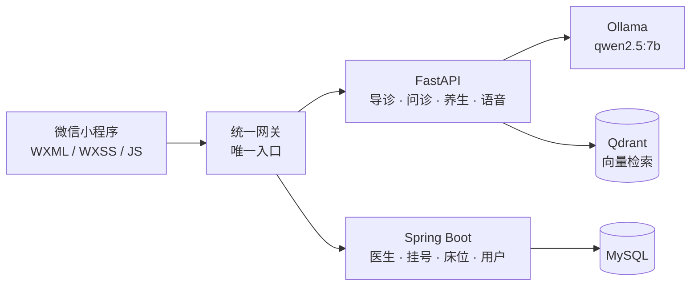

<div align="center">

# 康诊云

面向中老年患者的医疗健康 AI 微信小程序

说一句不舒服，它告诉你挂哪个科、有多急、怎么走。

[](LICENSE)
[](https://developers.weixin.qq.com/miniprogram/dev/framework/)
[](#)
[](#)
[](https://xiaodog22.github.io/aiyiliao/)

</div>

---

## 界面

在线浏览：<https://xiaodog22.github.io/aiyiliao/>（页面源码在 `site/index.html`，单文件、无外部依赖；2026-11-21 起含严格 CSP、反仿冒「安全与隐私」章节与 OG 元数据，回归见 `tools/test-site-index.js` 16 项）

<table>
  <tr>
    <td align="center"><br><sub>患者端 · 首页</sub></td>
    <td align="center"><br><sub>患者端 · 智能导诊</sub></td>
    <td align="center"><br><sub>患者端 · 预约挂号</sub></td>
  </tr>
  <tr>
    <td align="center"><br><sub>患者端 · 院内导航</sub></td>
    <td align="center"><br><sub>患者端 · 在线问诊</sub></td>
    <td align="center"><br><sub>医生端 · 工作台</sub></td>
  </tr>
</table>

## 为什么这么做

医院小程序的首页通常有十几个入口，年轻人都要点两遍才找对，对 68 岁的患者基本失效。真正卡住他的不是「入口在哪」，而是「我该去哪儿」。

所以这里的首页只有一个输入框：写一句或说一句哪里不舒服，系统给出科室、紧急程度和判断依据，后面的挂号、导航、报告都挂在这句话之后。

## 功能

| 模块 | 做什么 | 实现要点 |
| --- | --- | --- |
| 智能导诊 | 一句话描述症状，直接落到科室 | 15 类红旗症状先做急症筛查，18 个科室画像加权匹配，输出五级分级与命中理由；**红旗命中 → 结果页置顶红条 + 一键拨 120**（首页应急条同样可点，不只给文字） |
| AI 问诊 | 一句话出分诊结论 | 本地规则引擎先出结果，同时并发请求后端大模型融合；急诊信号取并集，任一通道报警即报警 |
| AI 养生 | 体质辨识 → 三天方案 | 膳食、功法、睡眠各一节，可投屏到电视 |
| 分步挂号 | 科室 → 医生 → 时段 → 确认 | 四步走完，由院内模拟系统受理并回传 HIS 单号（`bookingSource=HIS_MOCK`），记录页可查、可取消；取消会联动撤销 HIS 受理单 |
| 门诊缴费（演示） | 挂号成功后查看演示账单并入账 | 仅 DEMO 档，不调用 `wx.requestPayment`；金额取号源费，clinic-his 演示账单按 `appId+refType+refId` 幂等；成功文案固定「演示支付成功（未真实扣款）」；`PAID` 后可申请**演示退费**（`PAID→REFUNDED`，只改本地状态、不触发真实退款）；`APP_PAYMENT_ENABLED=false` 时仅显示「请到院窗口缴费」，并额外提供 0.01 元**本地模拟收银台**（不写后端） |
| 检查预约（演示） | 选检查项目/时段，建单并取消 | 仅演示排期，不接真实检查号源；项目/时段读 clinic-his，平台先 HIS 占位再落 V35 `exam_orders`；报告详情已展示 `examRequestNo` 字段（自动写回链路待接）；`APP_EXAM_ENABLED=false` 时只显示「检查预约暂未开放」 |
| 院内导航 | 1F 平面图 + 路径动画 | 起点是医院大门，14 个目的地，配文字步骤与语音播报 |
| 在线问诊 | 图文、报告、语音 | 患者端只能从健康档案选图（jpeg/png/webp ≤10MB，含系统推送的 `health.*` 报告图），服务端按 objectKey 归属 / 资源库白名单二次校验；接单前也可继续补充病情与资料；双方 2s 轮询同步，图片由服务端签名 URL 或匿名资源端点下发，医生看到与患者所选档案同一张图 |
| 消息通知 | 患者端消息中心 | 汇总挂号成功/预约状态、医生回复、系统通知、检查报告出具（READY 事件由后端幂等写入，同一报告仅 1 条，演示报告标题带“（演示）”）；未读红点取服务端 `unread-count`，点击按 `refType` 进入问诊会话 / 挂号记录 / 报告详情；缴费入口由挂号成功页直接跳转（演示），不依赖消息事件；病历查询类型已留展示映射，需后端事件写入后才出现，前端不伪造 |
| 医生工作台 | 接诊、叫号、床位申请 | 独立配色与鉴权，与患者端区分；床位申请默认从近期接诊患者选择，提交预约 ID 由服务端换取内部患者 ID，手动编号仅作兜底 |
| 健康科普 | 院内宣教材料 | 随包发布，断网可读 |
| 断网保护 | 后端不可达时只读、写操作拦截 | 连接状态分在线/降级/离线：已加载内容可继续看，顶部离线条标明“可能不是最新”；预约、问诊、床位申请等写请求统一返回 `OFFLINE`，不清会话、不跳登录；演示数据仅 `local` 档保留且显式标注 |

## 架构



前端只认一个地址，写在 `miniprogram/config/env.js` 的 `gateway` 里。业务代码中不出现上游端口，换部署环境只改这一处。

网关自身走 `/api/gw/**`，其余 `/api/**` 全量代理到上游；`/ai/health` 是唯一对外的 AI 探针。

链路追踪：客户端可带 `X-Request-Id`；未带时网关生成一次并**透传** Java / FastAPI，响应头与信封 `requestId` 用同一个值（`backend/edge-gateway/tests/test_request_id.py` 钉死）。此前三服务各生成一个 id，一次请求在日志里是三条互不关联的记录。

## 目录

```
miniprogram/          原生小程序前端
  pages/              主包 22 页（首页 / 问诊 / 养生 / 我的 + 登录 5 页 + 我的子页 11 页）
    doctor/           分包（root=pages/doctor）：医生端 5 页（2026-11-20 收缩至线上问诊），患者端不预载
    triage/           分包（root=pages/triage）：导诊 2 页（triage + result），首页 all 网络预载
    consult/          分包（root=pages/consult）：在线问诊 2 页（consult + picker）
    exam/             分包（root=pages/exam）：检查预约 1 页
    payment/          分包（root=pages/payment）：门诊缴费 1 页
    tv/               分包（root=pages/tv）：投屏 1 页
  packageNav/         分包：院内导航
  packageContent/     分包：健康科普
                      主包 22 + 7 分包 15 = 全量 **37 页**（以 app.json 实测为准，2026-11-20）
  services/           数据访问层，页面不直接发请求
  components/         通用组件（app.json 全局注册，页面可直接用标签）
  utils/              纯逻辑真源；submission-actions.js = 提交完成态操作入口状态机
  config/env.js       唯一网关地址
  config/api.js       唯一接口路径表
backend/
  edge-gateway/       统一网关（前端唯一入口）
  ai-service/         FastAPI：导诊 / 问诊 / 养生 / ASR / TTS
  business-service/   Spring Boot：医生 / 挂号 / 床位 / 用户
  deploy/             一键启停脚本与环境模板
docs/                 方案 / 契约 / 交付文档 / 手册 / 评审复盘 / 历史设计规范
  INDEX.md            文档总索引（按「设计 → 架构 → 数据库 → 测试 → 部署」分层）
  交付文档/           对外交付：后端功能测试设计、数据库表结构总览、代码规范
  手册/               操作手册 DOCX（含待转 PDF 稿）
  评审与复盘/          优化总结、待优化清单、测试用例调整建议
  v4/ 设计/ 运维/      契约总纲、设计方案、运维记录
  历史设计规范/        1.md~5.md、LAYOUT_PLAN.md、页面复刻方法（只读档案）
docs/screenshots/     界面截图
tools/                构建与校验脚本（依赖、样式、契约、分页、包体门禁等）
site/                 项目主页（单文件 HTML）
clinic-his/           社区诊所演示系统（模拟医院 HIS，Python 标准库 + SQLite，独立运行 :8310）
archive/              已退出活动链的本地归档（重复副本 / 旧产物 / 大备份包，不入库）
```

### 社区诊所演示系统（clinic-his，2026-11-19）

为验证预留的 HIS 对接接口，在根目录附带一套可独立运行的社区诊所系统（8 名医师 / 14 名护士 /
6 名行政 + 2 名医技，13 科室）。零第三方依赖，双击 `clinic-his/start.bat`（或 `python -m app.main`）
即启动于 `http://127.0.0.1:8310`，管理端按真实 HIS 业务域分 5 组导航（门诊／住院留观／药事／医技与公卫／运营与系统），
提供角色工作台待办、统一患者全视图、三栏医生站（候诊／结构化病历／诊断医嘱）、合理用药提示、病历质控、
留观床位与护理执行，以及药房、收费、医技、公卫、报表与审计；
对外 `/openapi/v1/*` 提供 HMAC 签名、Idempotency-Key 幂等与撤销受理，对应 `HisClient#book/cancel`。
后端已内置 `HttpHisClient`（`APP_HIS_MODE=http`）直接对接，联调三件套见
[clinic-his/README.md](clinic-his/README.md) §八；回归：`python clinic-his/scripts/smoke_test.py`（98 项，
自动使用隔离临时数据目录，可重复运行）。本机 `env.local` 已**默认接通**：
`APP_HIS_ENABLED=true` + `APP_HIS_MODE=http`（地址/凭据见同文件），挂号回执带 `his_order_no=CLN…`，
取消预约会联动撤销 HIS 受理单；要回到纯本地演示，把两值改回 `false`/`mock` 并重启 business。
安全上已按审查报告修复越权读病历、过敏开方硬阻断、账号恢复与退费闭环；
危急值报告会在工作台与医生站提示，并可一键引用回写病历。
数据与接口密钥写入 `clinic-his/data/`，已加入 `.gitignore`。

### 包体基线（2026-11-05 质量面板整改后）

| 项 | 体积 | 限制 |
| --- | --- | --- |
| 主包 | **1.343MB** | 微信硬上限 2MB |
| 分包 `packageContent` | 0.052MB | 单包 2MB |
| 分包 `packageNav` | 0.083MB | 单包 2MB |
| 包内图片+音频+视频 | **184.5KB** | 质量面板建议 200K |

整改前主包 2.101MB（超限）、全包媒体 787KB（质量面板未通过：图片 618K + mp4 170K）。
媒体（封面/海报/科普视频）已全部网络化出包（F2 Phase A+B），服务端副本与资源清单见
`docs/计划_云部署与包体整改_前端后端_20261104.md` §F1.1 与 §F2.1。
`node tools/check-project.js` 已内置包体门禁（主包 >1.7MB 告警 / >1.9MB 失败、单图 >100KB 失败、主包内音视频失败、分包图片音频 >200KB 告警）。

## 快速开始

**后端**（Windows）

```bash
cd backend/deploy
cp env.example env.local     # 填数据库连接与 AI 服务密钥
start-all.bat                # 或 start-gui.bat 用面板单独启停
```

**前端**

1. 微信开发者工具 → 导入 `miniprogram/`
2. 改 `miniprogram/config/env.js` 的 `gateway`，指向本机网关
3. 详情 → 本地设置 → 勾选「不校验合法域名」（本地网关是 http）

`env.local` 已在 `.gitignore` 中。仓库里只有模板，不含任何真实密钥。

演示支付默认开启（本机 `backend/deploy/env.local`：`APP_PAYMENT_ENABLED=true` +
`APP_PAYMENT_DEMO_SECRET=<至少 16 字符>`）。关闭时缴费页只显示「请到院窗口缴费」，并保留 0.01 元
本地模拟收银台（不写后端）；`APP_PAYMENT_MODE` 只能为 `DEMO`，填 `LIVE` 会启动即失败
（当前无企业主体/商户号）。退费为**演示态**：订单置 `REFUNDED`，不调用微信退款、不触发
clinic-his 退费（对端退费接口未在 openapi 暴露），页面固定标注“未发起真实退款”。

**个人主体演示兜底（2026-11-20）**

- 微信手机号：个人主体没有 `getPhoneNumber` 权限。患者登录按钮改为弹「模拟获取手机号」确认框，
  使用预置演示手机号 `13800138001` 走 dev 登录；全程不调用 `getPhoneNumber`、不在 WXML 声明
  `open-type`，避免预览/编译 errno 112。后端可达时是真会话；网关不可达时自动落**本地演示会话**
  （`demo=true`、无 token），可进入首页预览，但受保护业务接口仍会显示离线/错误态。
- 模拟支付：开发档首页「常用服务」下方有「演示模式 · 模拟支付（本地演示）」入口；支付页在真实支付
  关闭或订单读取失败时也显示「模拟支付（本地演示）」。点击后弹「模拟收银台」，生成 0.01 元本地演示单，
  只在页面内把状态置 PAID，**不写后端、不调起 `wx.requestPayment`、不产生真实扣款**。
- 上述入口均由 `ENV.legacyManualLoginEnabled` 控制，生产构建不渲染。
- 本地演示会话（`demo=true` 且无服务端 token）不再按 72h 真会话持久化：冷启动自动清理，预约提交前校验 `session.hasSession()`，无 token 时明确引导重新「模拟手机号登录」，避免提交后只看到 401。

检查预约同样默认关闭（`APP_EXAM_ENABLED=false`）。本机要演示，显式加 `APP_EXAM_ENABLED=true`；
`APP_EXAM_MODE` 也只能为 `DEMO`。项目/时段由 `APP_HIS_MODE=mock` 的进程内演示排期或
`APP_HIS_MODE=http` 的 clinic-his `/openapi/v1/exam-items` 提供，不接真实医院检查号源。

## 适老化

- 字号三档，随系统设置切换：40/34/30/24 → 44/36/32/26 → 52/42/38/30 rpx
- 触控热区不小于 48px，按钮不小于 56px
- 状态用图标 + 文字双通道，不靠颜色单独传达
- 颜色只有一个来源：`app.wxss` 里 `page{--*}` 的令牌块，页面不写字面色值

| 令牌 | 值 |
| --- | --- |
| 主蓝 | `#0B6EF8` |
| 辅助蓝 | `#3E8CFF` |
| 薄荷绿 | `#54C8A7` |
| 主文本 | `#14264C` |
| 页底 | `#F3F8FF` |

## 已知限制

- 导诊、问诊结论来自本地规则引擎与大模型，属演示性质，不能替代医生面诊
- 挂号流程用的是本地预约号，未对接医院 HIS；V1.20 只做**受限接入**（`HisClient` 接口 +
  `mock` 适配器，`app.his.enabled` 默认关闭，模拟单号前缀 `HIS-MOCK-`，不接真实凭据、不承诺真实号源），
  预约页与成功页标「演示预约」。另提供 `http` 档（`HttpHisClient`）**仅用于本地 clinic-his 联调**，
  且 `app.his.http.demo` 默认 true、回执来源仍按 `HIS_MOCK` 下发，不构成真实受理。演示期“后端主数据、HIS 辅助”的核对基线与整合顺序见
  `docs/clinic-his-integration/05_后端主数据整合基线_20261120.md`；当前未物理合库。逻辑整合已落地
  V36 `his_master_data_map`（仅 2 个科室 CONFIRMED、2 条 CONFLICT，医生 0 条 CONFIRMED），
  对账用 `python tools/his_reconcile.py`（只读，输出 `artifacts/his-reconcile/latest.md`）
- 电视投屏为本地模拟，DLNA / 局域网协议尚未接入
- 院内导航为 1F 示意平面图，不是全院楼层
- 语音能力按 `AI_DEGRADE_ENABLED` 总开关降级：开启=全链路（TTS：预生成→Qwen3→edge→WechatSI；ASR：本地 FunASR→WechatSI），
  关闭=仅本地；前端启动读取 `/api/v1/voice/capabilities` 快照，被否决的云端供应商不建连、不重试；全部失败时自动退回文字输入
- TTS L1 已接回：V02 `scripts/tts_sidecar_only.py`（默认 `127.0.0.1:9000`，`TTS_PRELOAD=1`）提供本地 Qwen3-TTS；V01 `AI_TTS_QWEN3_TIMEOUT_SECONDS=42`，
  预热后 10 字实测 22.5~29.2s（CPU RTF≈7~10×），缓存命中 158ms；sidecar 返回 `mock/degraded` 时 V01 拒绝冒充真实语音并切 edge
- 平台隐私授权已接入（`app.json` 的 `__usePrivacyCheck__` + `utils/privacy.js` 在录音前调 `wx.requirePrivacyAuthorize`）；
  **上线前仍需在小程序后台配置《隐私保护指引》**，并核对 `scope.record` 用途文案与实际采集一致
- 在线问诊仍是双端 2s 轮询（WebSocket 化需后端事件通道，列为 V1.21）
- 方言识别：本地 FunASR 只覆盖普通话；粤语（`zh-HK`）/四川话（`zh-SICHUAN`）显式 locale 走 WechatSI（仅总开关开启时），潮汕话不做专项模型，识别失败退回文字

## 性能测试

患者端只读链路 8 端点，终态基线（2026-11-01，三轮修复后）：

| 并发 | RPS | P50 | P95 | 错误率 |
| --- | --- | --- | --- | --- |
| 1 | **96.9** | 9.7ms | 15.5ms | 0% |
| 10 | 413.9 | 18.3ms | 50.7ms | 0% |
| 25 | **345.7** | 54.2ms | **185.9ms** | 0% |
| 50 | 276.4 | 176.0ms | 225.2ms | 0% |

> 1 VU 与 25 VU 为 v2.2（修 PERF-09 后）；10 VU 与 50 VU 仍是 v2.1 数据，未重测。

- 首轮未修复时 25 并发只有 55 RPS / P95 1115ms；修复后 **296.6 RPS / 213.7ms（5.4× / -81%）**，四档按自定阈值全达标（阈值未经业务确认）。
- **甜点并发是 10 VU**：413.9 RPS / P95 50.7ms 是吞吐最高、延迟最低的双优点；25 VU 掉 28%、50 VU 继续掉 —— 过拐点后加并发只增排队。扩 worker 的价值是**把拐点推远**，不是提高峰值。
- 两个 P0 根因，均零硬件投入：① 逐请求日志同步写控制台（`logging.perRequest=false` 已关）；② **venv 缺 `sniffio`**，导致 anyio 每次调用重扫 sys.path，py-spy 实测占 48.6% CPU（已补装并钉进 `requirements.txt`）。
- 跨实现校准：40 行 Node 反代同机同端点 **986 RPS**，证明"多一跳 / Windows loopback / 单事件循环"都不是瓶颈；剩余差距是 httpx+anyio+asyncio 的分布式开销，再上量级需换反代层。
- **多 worker 实测**：`--workers 2` 562.5 RPS（1.90×）、`--workers 4` 906.4 RPS（达同机直连 Java 的 84%，网关损耗从 20.6× 降到 1.19×）。但 2→4 只有 1.61×、主机 CPU 已 91~95% —— 瓶颈已转移到「施压端+网关+Java 三方抢 16 线程」，验证 8 worker 需先上独立压测机。
- **DB 全程未被压到**：25 VU / 60s 期间 MySQL CPU ≈0%、buffer pool 命中 100%、连接峰值 11/151、慢查询 0。**但全局 SQL 成本 20.7 次/请求**（正常应为 1~3），是换反代层后的下一个瓶颈。
- **口径**：闭合环极限口径、无思考时间，数字是"极限吞吐"不是"生产容量"；施压端与被压端同机，不得横向引用或外推为 SLA。
- 施压脚本：`tools/perf-runner.js`（零依赖，`node tools/perf-runner.js --scenario=read --vu=25 --duration=45`）；采样聚合：`artifacts/perf/pyspy-aggregate.js`。
- **PERF-09 已修（v2.2）**：`/doctors` 曾是 N+1（20 医生 = 41 SQL/请求），改为一次 `GROUP BY doctor_id` 批量聚合。实测 **1VU P50 55→14.5ms（-74%）、全局 1VU RPS +77%、SQL 20.67→8.92 次/请求（-56.9%）**。
- **性能回归门禁**：`node tools/perf-gate.js`（25VU/20s，预算 RPS 掉 10% / P95 涨 20% / 错误率 0.5%，退化 exit 1）。基线在 `artifacts/perf/baseline.json`（⚠️ **本地生成、不入库**，首次跑 `--update-baseline` 自建）。
- 完整报告：`artifacts/perf/03_性能测试报告_20261101.md` / `.html`（v2.2；⚠️ 本地生成、不入库）；选型与踩坑：[`docs/性能测试流水线_选型与落地附录_20261101.md`](docs/性能测试流水线_选型与落地附录_20261101.md)。

## 测试体系

| 层 | 载体 | 规模 |
| --- | --- | --- |
| Java 单元/契约/集成 | `backend/business-service/src/test` | 63 个测试类 / 401 项（`mvnw -o test` 实测，2026-11-20） |
| 网关行为 | `backend/edge-gateway/tests` | 134 项 pytest（含全链路 `X-Request-Id` 2 项） |
| SQL 次数预算（防 N+1） | `DoctorQueryBudgetTest` + `QueryCounter` | 5 项 |
| 端点级 SQL 画像 | `EndpointSqlProfileTest` | 2 项（逐端点上限 + 与数据量无关） |
| **小程序逻辑层（并发）** | `miniprogram/tests/` + `tools/test-fe.js` | **68 项 / 15 个测试文件**（零依赖 `node:test`；含隐私授权 6 项、患者端问诊/消息/接诊状态回归 5 项、音色映射/语速/语音取消与预取回归 5 项） |
| **导诊效果（golden set）** | `tools/data/triage-golden.json` + `tools/eval-triage.js` | **66 科室 + 20 红旗 + 3 兜底**；红旗召回/兜底 100% 为硬门禁，科室 Top-1 门槛 85% |
| **前后端契约快照** | `tools/contract-snapshot.js` + `contracts/snapshots/` | **5 端点**结构快照 |
| 持续集成 | `.github/workflows/ci.yml` | 4 job：前端 / Java / 网关 / AI（PR 阻断） |
| 性能回归门禁 | `tools/perf-gate.js` | 25VU/20s，支持 `--rounds=N` + 配置指纹 |
| **真库验证（MySQL）** | `tools/db-verify.js` | **37 项**（连接/Schema/约束/原子性/时区/Flyway/索引/权限），报告 `backend/deploy/DB_VERIFY_20261112.md` |
| **站点首页合规回归** | `tools/test-site-index.js` | **16 项**（免责声明原样展示 / 手机号·验证码控件缺失 / 原有结构交互 / 静态服务），报告 `docs/回归测试_站点首页_20261113.md` |

- 分层现状、技术选型取舍（为什么 Pact / MSW 在本项目用不了）与补齐顺序：`docs/测试体系_分层现状与补齐计划_20261101.md`。
- 日常门禁：`node tools/check-readme-links.js`（README / `docs/INDEX.md` 不得引用未入库路径）+ `node tools/check-project.js`（路径/禁址/图标/类名/事实源一致性/品牌名唯一性）+ `node tools/check-v4-docs.js`（路由登记与提示词结构）+ `mvnw -o test` + `pytest tests` + `node tools/test-fe.js` + `node tools/eval-triage.js` + `node tools/contract-snapshot.js --token=…`
  - `check-v4-docs` 自 2026-10-14 起长期因「路由登记缺口」红，**2026-11-16 已清零**（`DOC_CHECK_OK routes=36 prompts=24`）；它不并入 `check-project` 的原因是要读 `design-output/` 大文档，单跑更清晰——但必须与 `check-project` 同批执行，否则会再次静默漂移。
  - ⚠️ `check-v4-docs` / `check-v4-prototypes` 校验的 `design-output/`、`prototype-web/` **在 `.gitignore` 内**（设计存档与早期原型不入库）。干净 clone 下两者输出 `*_SKIP` 并 exit 0（不假红、也不冒充通过）；只有本机存在存档时才执行严格校验。因此这两项**不能作为 CI 阻断项**，只能作本地质量门禁。
- **契约快照语义**：只比结构与类型、不比值；字段消失/类型变化 → FAIL；**新增字段 → WARN 不阻断**。`--update` 会先打印差异，必须人工 review。
- **组件测试与 E2E 仍空白**（小程序原生栈无 DOM，需 `miniprogram-simulate`，代价高、优先级 P3）。
- **PERF-11（未修，P1）**：每请求**固定 5 次会话语句**（`Com_set_option` 4.08 + `Com_commit` 1.00），占 SQL 报文 83%。连接复用已证（`Threads_created` 40 次请求零增长），非建连成本；`useLocalSessionState` / `elideSetAutoCommits` 两个常见参数**实测无效**。端点自身只 1~4 次（`home/summary` 最贵），无 N+1 形态。
- AI 链路（分诊 / 问诊 / care-plan / TTS）**未做压测**：本机内存余量不足驻留 7B 模型。

## 持续集成

`.github/workflows/ci.yml` 在 push / PR 上跑四组**干净 clone 可复现**的门禁：

| job | 跑什么 |
| --- | --- |
| 前端 | `check-readme-links`（README + `docs/INDEX.md`）→ `check-require` / `check-exports` / `check-project` → `test-fe` / `test-triage` → `eval-triage` |
| Java | `mvnw -B test`（JDK 17 + H2，401 项） |
| 网关 | `pip install -r requirements.txt` + `pytest tests`（134 项） |
| AI | `pip install -r requirements.txt` + `pytest tests`（242 项） |

刻意不纳入 CI（不是遗漏，是口径）：`db-verify`（需真实 MySQL）、`perf-gate`（需三服务在线）、真机 / E2E（需设备与开发者工具）、`check-v4-docs` / `check-v4-prototypes`（依赖 `.gitignore` 内设计存档，clone 下只会 SKIP）。**SKIP 不等于通过**，因此不作阻断项。

## 开发记录

### 2026-11-13 全量回归实测 + V1.20 规划文档批（零代码改动）

一轮全量实跑：前端全部门禁与排版终判（NAV_PREVIEW_OK / PAD_LAYOUT_OK 16/16，主包实测 **1.363MB**）、
Java **322/0**、网关 **132**、ai-service **213** 全绿；1 项新失败完整归因（音色「设默认」被迟到的远端目录响应覆盖，
voice.js:156-158 → 101-104 连锁复位，登记 V1.20 T1-1）；3 项登记在案失败（profile 断言① / v4-docs 11 条路由 / v4-prototypes）复测确认，列 T1-2 收口。
联调档（contract-snapshot / perf-gate / resource-links）因三服务未在线 SKIP。全部规划文档归档 **[docs/下一阶段_20261113/](docs/下一阶段_20261113/INDEX.md)**：
测试报告与测试计划、页面 UI 与代码功能两份改进计划、V1.20 迭代计划（四批次 + 里程碑验收门 + 明确不做清单）。

### 2026-11-12 缺陷清单（17 条）修复批次

按《缺陷清单_20261112.md》逐条修复，并在同批次做同类问题排查。落地后新增四条**运行时不变式**，
后续开发请按它们自查：

| 不变式 | 落点 | 回归守卫 |
| --- | --- | --- |
| 带 `familyMemberId` 的写路径（档案 / 挂号 / 改约）必须 `proxyStatus=GRANTED` | `FamilyProxyGuard`（唯一入口） | `M1IntegrationTest.未授权家庭成员_代挂号404_授权后放行` |
| 同一用户同一号源只允许一笔在办预约（PENDING/CONFIRMED/CHECKED_IN） | `AppointmentRepository.hasActiveAppointment` | `M1IntegrationTest.同号源重复建单_409_…` |
| 时间字段只有一套解析：ISO Instant → `utils/datetime.js`（禁字符串截取） | `services/appointment.js` / reports 两页 | `test-fe-datetime.js` DT-12~15 |
| 兜底科室（全科医学科）不作确定结论，页面改「导诊台 / 全科」说明 | `triage-engine.noConclusion` | `test-patient-deep-audit.js` C11/C12 |

其余：附件与头像落盘前比对**文件头魔数**（`FileMagic`，伪装文件 415）；导诊会话落 storage 可恢复
（switchTab 不再清空对话）；三个输入框补 `maxlength`（1000/2000）且纯标点不再发请求；
网关对非 ASCII 请求头回 400（不再 500）；取消预约用 `Idempotency-Replayed` 头区分「首次/重放」；
契约补登记 5 个已实现端点。**未完成/待确认项见 `DEV_LOG.md` 同日条目末尾**（DB 唯一索引、限流生产开关）。


- [DEV_LOG_README.md](DEV_LOG_README.md)：2026-10-30 之前的 README，已归档
- `DEV_LOG.md`、`AI_CONTEXT.md`：本地开发日志与上下文索引，含内部联调信息，不随仓库发布
- `artifacts/db-doc/wechar数据库说明文档.docx`（2026-11-05）：完整数据库说明文档，覆盖**当时 36 张表**的字段/索引/约束、
  真实数据样例与枚举、库表设计说明、跨服务关联与「待补充」清单；只读采集，业务库零写入。
  可复现链：`artifacts/db-doc/export_db_data.py` → `facts.json` → `build_doc.py` → `final_draft.md` → `md_to_html.py`。
  ⚠️ `artifacts/` 是本地生成目录（含数据采集结果与全库基线 SQL），**不入库**；克隆后需按需自行重建。
- `backend/deploy/REPORT_DELIVERY_20261105.md`（2026-11-05）：电子检查报告体系交付报告（V27/V9010/V9011 迁移、
  4 张新表、3 个演示患者、报告列表/详情页、状态门禁与权限实测、ER 前后对比、备份与未解决问题）。
  阶段 01 审计见 `DB_AUDIT_20261105.md`，结构定稿见 `DB_SCHEMA_DESIGN_20261105.md`。
  ⚠️ H2 单测档因 V27 含 MySQL 专有 DDL 停在 `spring.flyway.target=26.5`（26.x 只补 H2 等价列/表，如 messages.biz_key、payment_orders、exam_orders）；真实库已应用 V27/V28/V33/V34/V35（报告投影、消息幂等键、演示支付订单、检查预约），2026-11-20 新版 business 重启实测 `Schema up to date. No migration necessary`。

## 文档

按「设计 → 架构 → 数据库 → 测试 → 部署」分层，完整索引见 **[docs/INDEX.md](docs/INDEX.md)**。

> **可点性约定**：本文只对**已入库文件**使用 Markdown 链接；标注「仅本地」「不入库」的路径一律用反引号文字，
> 不再写成链接。干净克隆可达性由 `node tools/check-readme-links.js` 守卫（缺失或未入库即 exit 1），已接入 CI。

- **发布状态唯一汇总：[RELEASE_STATUS.md](RELEASE_STATUS.md)** —— 每个功能的实现程度 / 证据 / 责任人 / 最后验证时间；本文与之冲突时以状态表为准。
- 界面规范**唯一真源 = 代码本身**：`miniprogram/app.wxss` 的 `page{--*}` 令牌块 + 各页 `wxss/wxml`（改样式只改这里）。
  设计阶段存档（`docs/历史设计规范/1.md~5.md`、`design-output/` 的 UIUX 说明书 V4）**仅本地保留、不入库**：
  `1.md~5.md` 属早期草稿，UIUX V4 是设计交付稿；两者都可能与当前代码有出入，**不作为验收依据**。
  仓库内可点的只有 [`LAYOUT_PLAN.md`](docs/历史设计规范/LAYOUT_PLAN.md)（版式方案档案）。
- 架构与契约：[`docs/v4/`](docs/v4/)、[`backend/contracts/business-openapi.yaml`](backend/contracts/business-openapi.yaml)（⚠️ **to-be 目标态契约，不是当前实现事实**，见 AGENTS.md 红线）
- 数据库：[`数据库表结构总览`](docs/交付文档/数据库表结构总览_20261022.md)、[`DATA_GOVERNANCE.md`](backend/deploy/DATA_GOVERNANCE.md)、[检查报告体系交付报告](backend/deploy/REPORT_DELIVERY_20261105.md)
- 协作规范：[`AGENTS.md`](AGENTS.md)；`WORKBODY_AGENT_RULES.md`（42 节完整 AI 工程规范）**仅本地保留、不入库**。
- 全量文档分类库（2026-11-17）：`docs/文档整理_20261117/00_索引.md`（246 份原文件按作用 + 时间分 12 个内容类，另设 00 索引；原文件不搬迁，20 份重点副本；本地整理，未入库）。

## 小程序联调测试（E2E + JMeter）

一键编排与完整说明见 **[tools/e2e-weapp/README.md](tools/e2e-weapp/README.md)**。

- `node tools/e2e-weapp/run-all.js`：环境自检 → 小程序 UI E2E（首页→导诊、预约挂号两条旅程）→ JMeter 5.4.1 网关冒烟，产出 `artifacts/e2e-weapp/report-latest.md`。
- 后端离线时自动切换「离线自检」：只验证 JMX / JTL 链路，不自造连接失败样本、不伪造性能数据；开发者工具或 automator SDK 缺失时明确 SKIP 并列出具体原因。
- 测试套件零业务代码改动；网关地址取自 `config/env.js`、健康路径取自 `config/api.js`，JMX 只用内置组件、不依赖第三方插件。`check-project` 门禁全绿，主包 1.363MB 不变。
- USB 真机实测（2026-11-14，Xiaomi M2007J17C / Android 16）报告在 `artifacts/e2e-weapp/device-20261114-1737/device-test-report.md`（⚠️ **本地生成、不入库**）：42 项 PASS 34 / FAIL 2 / BLOCKED 2 / 观察 4，含逐项预期与实际、复现步骤、日志线索与问题清单。
- 已接入 Postman CLI / Newman 适配器与统一结果 `artifacts/e2e-weapp/report-latest.json`（ui / api / load 三段 schema）；DSH NEXT 集成见 `.agents/skills/wechar-unified-test/SKILL.md`（工作区级 skill）与 `tools/e2e-weapp/mcp/`（零依赖 stdio MCP server）。

## 真机 adb 测试（device-test）

与上面的开发者工具链路互补：只依赖 adb，跑真机维度断言。说明见 **[tools/device-test/README.md](tools/device-test/README.md)**，
skill 见 `.workbuddy/skills/wechar-device-test/SKILL.md`。

- `node tools/device-test/run.js --list`：列出用例（`cases/*.json`）。
- `node tools/device-test/run.js --case appointment-demo`：连设备 → 截图 → logcat 无崩溃 → 预约列表接口可读。
- `node tools/device-test/run.js --case his-booking-fields --token <bearer>`：断言 REQ-14 的 `bookingSource` 契约字段。
- 无 adb / 无设备 / 无 token 一律 SKIP（退出码 2），不写成 PASS；证据落 `artifacts/device-test/<case>-<时间戳>/`。

## 贡献

见 **[CONTRIBUTING.md](CONTRIBUTING.md)**（环境、启动、9 条代码红线、数据库迁移规则、提交前必跑的四条验证命令）。
CI 见 **`.github/workflows/ci.yml`**（Java / ai / gateway / 前端 / 结构 / 契约 / 安全门禁）；本地仍以 `check-project` / `test-fe` / `mvnw test` / `pytest` 为并行门禁。

## 安全

漏洞请走 GitHub Security Advisory 私密渠道，不要开公开 Issue，详见 **[SECURITY.md](SECURITY.md)**。

### 2026-11-18 敌意审计整改（39 项发现的落地情况）

基线报告：`aiyiliao_敌意安全审计报告.docx`（CRITICAL 3 / HIGH 11 / MEDIUM 14 / LOW 11）。
本轮修复以「不改变现有功能与行为」为前提，逐项落地情况与残留风险见 `DEV_LOG.md` 对应条目。

**已收口的关键红线**：

| 项 | 口径 |
| --- | --- |
| C2 路径穿越 | `resolve_audio_path` 只接受 `^[A-Za-z0-9_-]{1,64}$` 的 ref_id，且 `resolve()` 后必须仍在音频目录内；`inputRef` 在 Pydantic 层就用同一正则拦截 |
| C3 服务间零信任 | business 启动即校验 `AI_SERVICE_TOKEN`（≥32 字符，缺失/过短拒绝启动）；ai 侧 `/internal/v1/tasks` 的读取/取消/SSE 订阅必须带 `X-Tenant-Id` 且与任务租户一致（不符按 404）；幂等键并入租户哈希 |
| C1 联调密钥 | `DEV_LOGIN_KEY` 已轮换，旧值（`21cb…` / `2818…`）进后端**永久黑名单**（配置成旧值会拒绝启动）；production 档该常量恒为空并带构建期守卫 |
| H3 身份回退 | strict 档删除 `X-User-Id` / 「非 `at-` 令牌即 openid」两条回退；无身份时 `currentUserId()` 抛 401，不再兜底 `dev-user-1` |
| H6 限流 | 网关 `rateLimit.enabled=true` 成为部署默认；转发前统一归一 `X-Forwarded-For`（不信任客户端自报）；business 登录限流改按归一后的客户端 IP |
| H10 数据出境 | 新增 `AI_EGRESS_POLICY=domestic`（境外 provider 一律否决）；DeepSeek / edge-tts 调用前强制 `deep_sanitize()` 打码 |
| H11 探针 | `probe_redis` 改线程池执行（不再阻塞事件循环）；未持服务令牌只回 `{status, degraded}`；探针 30 次/分/IP |
| H1/H2 认证强度 | `app.sms.provider` 缺省反转为 `prod`（漏配即如实 503）；手机号写入改 HMAC-SHA256（`APP_PHONE_HMAC_KEY`），支持 `APP_PHONE_HMAC_KEY_PREVIOUS` 轮换双读（当前 → 上一把 → 旧 SHA），命中旧摘要自动回写；验证码摘要走 `APP_CODE_HASH_SECRET` + 原子扣减 |
| H5 投屏越权 | gateway `cast/devices|pair|push` 不再只看 `at-` 前缀，统一向 business `/api/v1/auth/whoami` 反查 `roles` 含 `DOCTOR`；患者 403，business 不可达 503（fail-closed） |
| M5 头像枚举 | `GET /api/v1/avatars/{name}` 必须带 900s HMAC 短签（`expires`+`sig`）；裸文件名/过期/篡改 403，缓存改 `private, 15m` |
| M11 同意版本 | 新增匿名 `GET /api/v1/consent/latest` + `APP_CONSENT_VERSION`；登录旧版本 409；前端新增独立同意页，版本与点击时间分别记录，`env.js` 不再写死版本 |
| M12/M13/M14 会话 | `/auth/session` 派生会话上限 3 且写 `parent_session_id`；refresh TTL 24h；`whoami` 为服务端权威角色，`wb_role` 不再本地落盘；退出必须服务端 2xx 才清本地令牌 |
| M2 静态加密 | `tasks.json` 的 `result` 正文用 Fernet 加密（`AI_STORE_ENCRYPTION_KEY`，生产 compose 必填）；终态剥离 `inputInline`；**活动任务 `inputInline` 同 key 加密**（F-03）；`AI_STORE_REQUIRE_ENCRYPTION=true` 时缺 key 拒绝启动；0600/0700；密钥不匹配/密文篡改时丢弃快照 |
| M3/M4 租户配额 | SSE 全局 64 + 单租户 3（`AI_STREAM_MAX_CONNECTIONS_PER_TENANT`）；TTS 2000 字/512MB + 租户 6 次/分、200 次/日（`AI_TTS_TENANT_PER_MINUTE/DAY`），超限 429 `TTS_QUOTA_EXCEEDED` |
| M7 幂等键 | 服务端按 tenant 域化；前端 `newIdempotencyKey()` 固定生成 32 位小写 hex |

**仍需排期（不阻塞本轮）**：
refresh token 本地 at-rest 加密（微信无应用级安全存储）、
`DevSmsSender.lastCodes` 仅 dev 的内存明文（生产不可达，后续改测试注入）、
ASR 上传魔数嗅探（L9）、SBOM（L6）、prod 档 JDBC 变量强制注入（L5）、
M11/M13 的真机渲染与全局 `Page` 包装实测。

### 本地联调档（`env.local.js`，不入库）

2026-11-18 起 `miniprogram/config/env.js` **不再包含任何真实地址或密钥**：
档位、隧道域名、dev 登录密钥全部来自本地未入库的 `miniprogram/config/env.js` 同目录
`env.local.js`（`.gitignore` 已忽略）。没有该文件时构建 fail-closed 到 `production`
（dev 登录与隧道全部关闭）。

```js
// miniprogram/config/env.local.js（自己创建，勿提交）
module.exports = {
  buildEnv: 'development',                 // 真机联调；不写 = production
  developmentGateway: 'https://<你的隧道域名>',
  devLoginKey: '<与 backend/deploy/env.local 的 APP_AUTH_DEV_LOGIN_KEY 同值>'
}
```

发布前跑 `node tools/check-build-env.js`（不带 `--allow-dev`）：它要求默认档位为 `production`、
`env.js` 内不含隧道域名/联调密钥，并校验后端默认档位与闸门默认关闭。
`node tools/security-gate.js` 是仓库级敏感信息门禁（已纳入 `.github/workflows/ci.yml` 的 `security` job），两者应同时为绿。

## 免责声明

本项目是**技术演示与教学项目**，不是医疗器械，未取得任何医疗器械注册/备案资质，
输出内容不构成诊断、处方或治疗建议，**不得用于真实诊疗**。仓库内患者、医生、机构、检查结果
均为模拟数据（编号 `DEMO-*`，机构名带「（模拟）」），不含真实个人信息、签名或公章。
如需用于临床或商业场景，须自行完成合规评估与资质申请。

## 许可

[MIT](LICENSE)


## 社区诊所 HIS 整合（2026-11-19）

- 新增 `clinic-his/` 社区诊所演示 HIS（Python 标准库 + SQLite，管理端 8310）。
- 整合结论：**HIS 为临床主数据源，平台为患者身份/触达主数据源；逻辑合并、物理分库**，不做 SQLite/MySQL 双写。
- 已完成：OpenAPI 跨租户越权修复、患者嵌套资源权限收口、病历/处方/检查/缴费单 PDF 与打印、10 分钟签名链接、打印审计；护士站床位审批（`/api/v1/nurse/bed-applications` + `/nurse-station/index.html`，病区终端令牌模式）。
- 护士站启用：启动 business-service 前设置 `NURSE_STATION_TOKEN`（至少 16 位随机串），打开 `http://127.0.0.1:8088/nurse-station/index.html`，填入令牌与病区 ID；通过申请时填床位 ID（已有床直接确定），系统校验病区归属与空闲状态后落床。
- 设计文档：`docs/clinic-his-integration/00~04`。
- 验证：`python -m py_compile` + 副本 8311 安全/PDF 回归；详见 `DEV_LOG.md` 2026-11-19。
