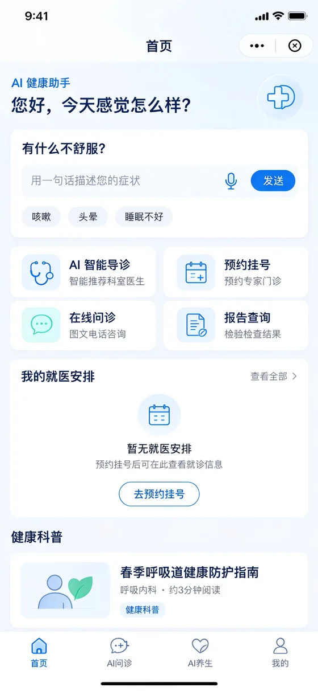
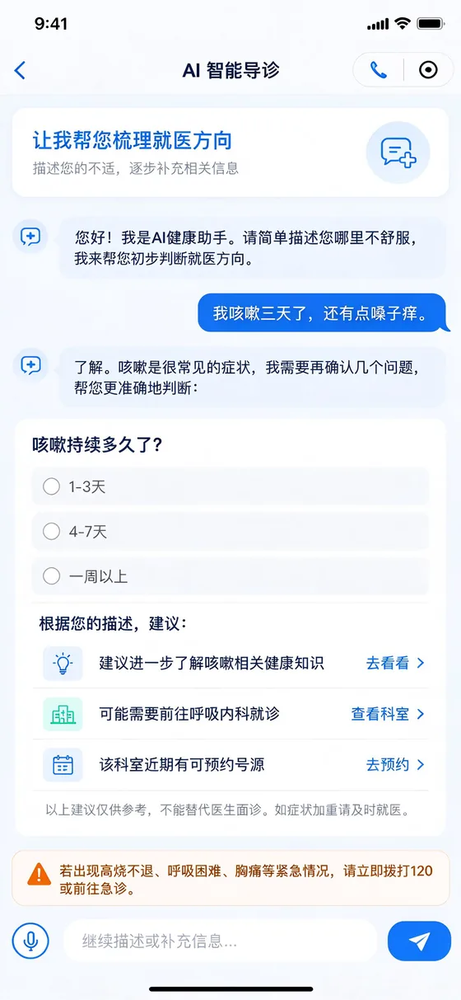
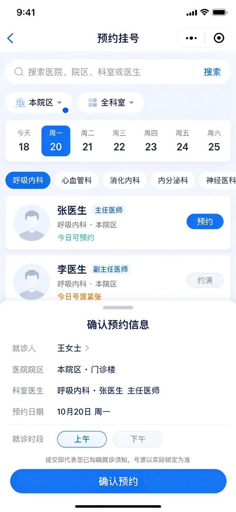
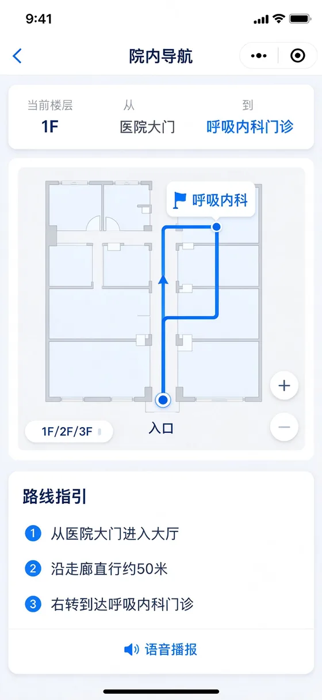
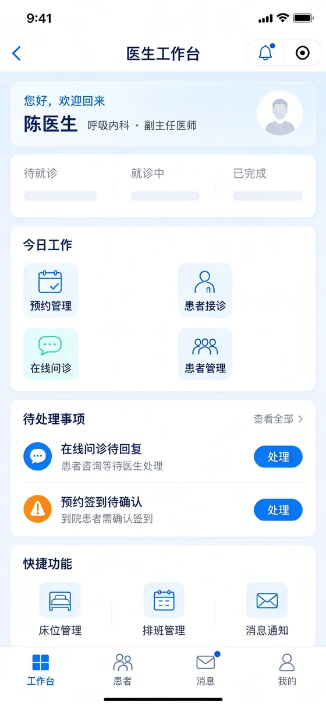
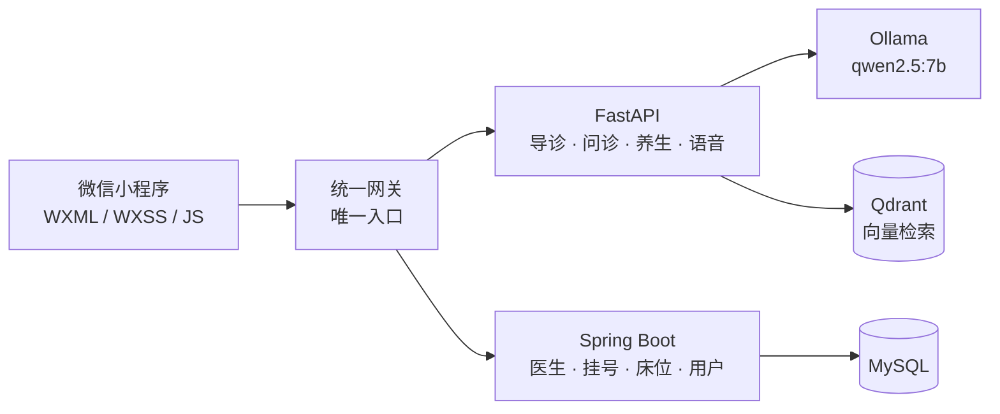

<div align="center">

# 大夫

面向中老年患者的医疗健康 AI 微信小程序

说一句不舒服，它告诉你挂哪个科、有多急、怎么走。

[](LICENSE)
[](https://developers.weixin.qq.com/miniprogram/dev/framework/)
[](#)
[](#)

</div>

---

## 界面

<table>
  <tr>
    <td align="center"><br><sub>患者端 · 首页</sub></td>
    <td align="center"><br><sub>患者端 · 智能导诊</sub></td>
    <td align="center"><br><sub>患者端 · 预约挂号</sub></td>
  </tr>
  <tr>
    <td align="center"><br><sub>患者端 · 院内导航</sub></td>
    <td align="center"><br><sub>患者端 · 在线问诊</sub></td>
    <td align="center"><br><sub>医生端 · 工作台</sub></td>
  </tr>
</table>

## 为什么这么做

医院小程序的首页通常有十几个入口，年轻人都要点两遍才找对，对 68 岁的患者基本失效。真正卡住他的不是「入口在哪」，而是「我该去哪儿」。

所以这里的首页只有一个输入框：写一句或说一句哪里不舒服，系统给出科室、紧急程度和判断依据，后面的挂号、导航、报告都挂在这句话之后。

## 功能

| 模块 | 做什么 | 实现要点 |
| --- | --- | --- |
| 智能导诊 | 一句话描述症状，直接落到科室 | 15 类红旗症状先做急症筛查，18 个科室画像加权匹配，输出五级分级与命中理由 |
| AI 问诊 | 一句话出分诊结论 | 本地规则引擎先出结果，同时并发请求后端大模型融合；急诊信号取并集，任一通道报警即报警 |
| AI 养生 | 体质辨识 → 三天方案 | 膳食、功法、睡眠各一节，可投屏到电视 |
| 分步挂号 | 科室 → 医生 → 时段 → 确认 | 四步走完，本地生成预约号，记录页可查 |
| 院内导航 | 1F 平面图 + 路径动画 | 起点是医院大门，14 个目的地，配文字步骤与语音播报 |
| 在线问诊 | 图文、报告、语音 | 患者端与医生端共用一套消息与附件通道 |
| 医生工作台 | 接诊、叫号、处理 | 独立配色与鉴权，与患者端区分 |
| 健康科普 | 院内宣教材料 | 随包发布，断网可读 |

## 架构



前端只认一个地址，写在 `miniprogram/config/env.js` 的 `gateway` 里。业务代码中不出现上游端口，换部署环境只改这一处。

网关自身走 `/api/gw/**`，其余 `/api/**` 全量代理到上游；`/ai/health` 是唯一对外的 AI 探针。

## 目录

```
miniprogram/          原生小程序前端
  pages/              主包 21 页（首页 / 导诊 / 问诊 / 养生 / 挂号 / 我的 / 医生工作台）
  packageNav/         分包：院内导航
  packageContent/     分包：健康科普
  services/           数据访问层，页面不直接发请求
  config/env.js       唯一网关地址
  config/api.js       唯一接口路径表
backend/
  edge-gateway/       统一网关（前端唯一入口）
  ai-service/         FastAPI：导诊 / 问诊 / 养生 / ASR / TTS
  business-service/   Spring Boot：医生 / 挂号 / 床位 / 用户
  deploy/             一键启停脚本与环境模板
tools/                构建与校验脚本（依赖、样式、契约、分页等）
site/                 项目主页（单文件 HTML）
docs/screenshots/     界面截图
```

## 快速开始

**后端**（Windows）

```bash
cd backend/deploy
cp env.example env.local     # 填数据库连接与 AI 服务密钥
start-all.bat                # 或 start-gui.bat 用面板单独启停
```

**前端**

1. 微信开发者工具 → 导入 `miniprogram/`
2. 改 `miniprogram/config/env.js` 的 `gateway`，指向本机网关
3. 详情 → 本地设置 → 勾选「不校验合法域名」（本地网关是 http）

`env.local` 已在 `.gitignore` 中。仓库里只有模板，不含任何真实密钥。

## 适老化

- 字号三档，随系统设置切换：40/34/30/24 → 44/36/32/26 → 52/42/38/30 rpx
- 触控热区不小于 48px，按钮不小于 56px
- 状态用图标 + 文字双通道，不靠颜色单独传达
- 颜色只有一个来源：`app.wxss` 里 `page{--*}` 的令牌块，页面不写字面色值

| 令牌 | 值 |
| --- | --- |
| 主蓝 | `#0B6EF8` |
| 辅助蓝 | `#3E8CFF` |
| 薄荷绿 | `#54C8A7` |
| 主文本 | `#14264C` |
| 页底 | `#F3F8FF` |

## 已知限制

- 导诊、问诊结论来自本地规则引擎与大模型，属演示性质，不能替代医生面诊
- 挂号流程用的是本地预约号，未对接医院 HIS
- 电视投屏为本地模拟，DLNA / 局域网协议尚未接入
- 院内导航为 1F 示意平面图，不是全院楼层
- 语音能力依赖后端在线，失败时自动退回文字输入
- 未接入微信隐私授权接口，生产环境需要补

## 开发记录

- [DEV_LOG_README.md](DEV_LOG_README.md)：2026-10-30 之前的 README，已归档
- `DEV_LOG.md`、`AI_CONTEXT.md`：本地开发日志与上下文索引，含内部联调信息，不随仓库发布

## 许可

[MIT](LICENSE)
