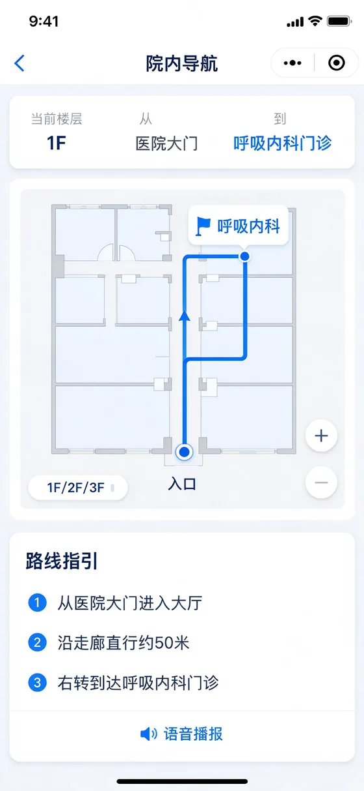
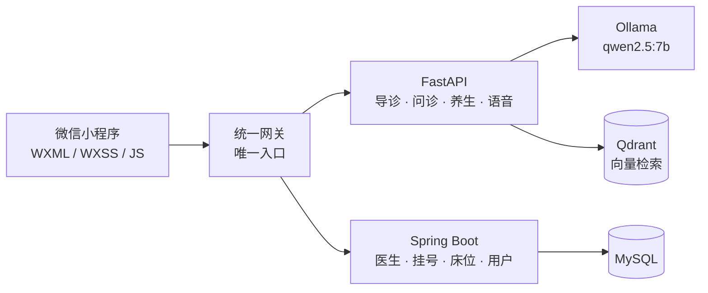

<div align="center">

# 康诊云

面向中老年患者的医疗健康 AI 微信小程序

说一句不舒服，它告诉你挂哪个科、有多急、怎么走。

[](LICENSE)
[](https://developers.weixin.qq.com/miniprogram/dev/framework/)
[](#)
[](#)
[](https://xiaodog22.github.io/aiyiliao/)

</div>

---

## 界面

在线浏览：<https://xiaodog22.github.io/aiyiliao/>（页面源码在 `site/index.html`，单文件、无外部依赖）

<table>
  <tr>
    <td align="center"><br><sub>患者端 · 首页</sub></td>
    <td align="center"><br><sub>患者端 · 智能导诊</sub></td>
    <td align="center"><br><sub>患者端 · 预约挂号</sub></td>
  </tr>
  <tr>
    <td align="center"><br><sub>患者端 · 院内导航</sub></td>
    <td align="center"><br><sub>患者端 · 在线问诊</sub></td>
    <td align="center"><br><sub>医生端 · 工作台</sub></td>
  </tr>
</table>

## 为什么这么做

医院小程序的首页通常有十几个入口，年轻人都要点两遍才找对，对 68 岁的患者基本失效。真正卡住他的不是「入口在哪」，而是「我该去哪儿」。

所以这里的首页只有一个输入框：写一句或说一句哪里不舒服，系统给出科室、紧急程度和判断依据，后面的挂号、导航、报告都挂在这句话之后。

## 功能

| 模块 | 做什么 | 实现要点 |
| --- | --- | --- |
| 智能导诊 | 一句话描述症状，直接落到科室 | 15 类红旗症状先做急症筛查，18 个科室画像加权匹配，输出五级分级与命中理由 |
| AI 问诊 | 一句话出分诊结论 | 本地规则引擎先出结果，同时并发请求后端大模型融合；急诊信号取并集，任一通道报警即报警 |
| AI 养生 | 体质辨识 → 三天方案 | 膳食、功法、睡眠各一节，可投屏到电视 |
| 分步挂号 | 科室 → 医生 → 时段 → 确认 | 四步走完，本地生成预约号，记录页可查 |
| 院内导航 | 1F 平面图 + 路径动画 | 起点是医院大门，14 个目的地，配文字步骤与语音播报 |
| 在线问诊 | 图文、报告、语音 | 患者端与医生端共用一套消息与附件通道 |
| 医生工作台 | 接诊、叫号、处理 | 独立配色与鉴权，与患者端区分 |
| 健康科普 | 院内宣教材料 | 随包发布，断网可读 |

## 架构



前端只认一个地址，写在 `miniprogram/config/env.js` 的 `gateway` 里。业务代码中不出现上游端口，换部署环境只改这一处。

网关自身走 `/api/gw/**`，其余 `/api/**` 全量代理到上游；`/ai/health` 是唯一对外的 AI 探针。

## 目录

```
miniprogram/          原生小程序前端
  pages/              主包 31 页（首页 / 导诊 / 问诊 / 养生 / 挂号 / 我的 / 医生工作台 等）
  packageNav/         分包：院内导航
  packageContent/     分包：健康科普
  services/           数据访问层，页面不直接发请求
  components/         通用组件（app.json 全局注册，页面可直接用标签）
  utils/              纯逻辑真源；submission-actions.js = 提交完成态操作入口状态机
  config/env.js       唯一网关地址
  config/api.js       唯一接口路径表
backend/
  edge-gateway/       统一网关（前端唯一入口）
  ai-service/         FastAPI：导诊 / 问诊 / 养生 / ASR / TTS
  business-service/   Spring Boot：医生 / 挂号 / 床位 / 用户
  deploy/             一键启停脚本与环境模板
docs/                 方案 / 契约 / 交付文档 / 手册 / 评审复盘 / 历史设计规范
  INDEX.md            文档总索引（按「设计 → 架构 → 数据库 → 测试 → 部署」分层）
  交付文档/           对外交付：后端功能测试设计、数据库表结构总览、代码规范
  手册/               操作手册 DOCX（含待转 PDF 稿）
  评审与复盘/          优化总结、待优化清单、测试用例调整建议
  v4/ 设计/ 运维/      契约总纲、设计方案、运维记录
  历史设计规范/        1.md~5.md、LAYOUT_PLAN.md、页面复刻方法（只读档案）
docs/screenshots/     界面截图
tools/                构建与校验脚本（依赖、样式、契约、分页、包体门禁等）
site/                 项目主页（单文件 HTML）
archive/              已退出活动链的本地归档（重复副本 / 旧产物 / 大备份包，不入库）
```

### 包体基线（2026-11-05 质量面板整改后）

| 项 | 体积 | 限制 |
| --- | --- | --- |
| 主包 | **1.327MB** | 微信硬上限 2MB |
| 分包 `packageContent` | 0.048MB | 单包 2MB |
| 分包 `packageNav` | 0.083MB | 单包 2MB |
| 包内图片+音频+视频 | **193KB**（197,638B） | 质量面板建议 200K |

整改前主包 2.101MB（超限）、全包媒体 787KB（质量面板未通过：图片 618K + mp4 170K）。
媒体（封面/海报/科普视频）已全部网络化出包（F2 Phase A+B），服务端副本与资源清单见
`docs/计划_云部署与包体整改_前端后端_20261104.md` §F1.1 与 §F2.1。
`node tools/check-project.js` 已内置包体门禁（主包 >1.7MB 告警 / >1.9MB 失败、单图 >100KB 失败、主包内音视频失败、分包图片音频 >200KB 告警）。

## 快速开始

**后端**（Windows）

```bash
cd backend/deploy
cp env.example env.local     # 填数据库连接与 AI 服务密钥
start-all.bat                # 或 start-gui.bat 用面板单独启停
```

**前端**

1. 微信开发者工具 → 导入 `miniprogram/`
2. 改 `miniprogram/config/env.js` 的 `gateway`，指向本机网关
3. 详情 → 本地设置 → 勾选「不校验合法域名」（本地网关是 http）

`env.local` 已在 `.gitignore` 中。仓库里只有模板，不含任何真实密钥。

## 适老化

- 字号三档，随系统设置切换：40/34/30/24 → 44/36/32/26 → 52/42/38/30 rpx
- 触控热区不小于 48px，按钮不小于 56px
- 状态用图标 + 文字双通道，不靠颜色单独传达
- 颜色只有一个来源：`app.wxss` 里 `page{--*}` 的令牌块，页面不写字面色值

| 令牌 | 值 |
| --- | --- |
| 主蓝 | `#0B6EF8` |
| 辅助蓝 | `#3E8CFF` |
| 薄荷绿 | `#54C8A7` |
| 主文本 | `#14264C` |
| 页底 | `#F3F8FF` |

## 已知限制

- 导诊、问诊结论来自本地规则引擎与大模型，属演示性质，不能替代医生面诊
- 挂号流程用的是本地预约号，未对接医院 HIS
- 电视投屏为本地模拟，DLNA / 局域网协议尚未接入
- 院内导航为 1F 示意平面图，不是全院楼层
- 语音能力依赖后端在线，失败时自动退回文字输入
- 未接入微信隐私授权接口，生产环境需要补

## 性能测试

患者端只读链路 8 端点，终态基线（2026-11-01，三轮修复后）：

| 并发 | RPS | P50 | P95 | 错误率 |
| --- | --- | --- | --- | --- |
| 1 | **96.9** | 9.7ms | 15.5ms | 0% |
| 10 | 413.9 | 18.3ms | 50.7ms | 0% |
| 25 | **345.7** | 54.2ms | **185.9ms** | 0% |
| 50 | 276.4 | 176.0ms | 225.2ms | 0% |

> 1 VU 与 25 VU 为 v2.2（修 PERF-09 后）；10 VU 与 50 VU 仍是 v2.1 数据，未重测。

- 首轮未修复时 25 并发只有 55 RPS / P95 1115ms；修复后 **296.6 RPS / 213.7ms（5.4× / -81%）**，四档按自定阈值全达标（阈值未经业务确认）。
- **甜点并发是 10 VU**：413.9 RPS / P95 50.7ms 是吞吐最高、延迟最低的双优点；25 VU 掉 28%、50 VU 继续掉 —— 过拐点后加并发只增排队。扩 worker 的价值是**把拐点推远**，不是提高峰值。
- 两个 P0 根因，均零硬件投入：① 逐请求日志同步写控制台（`logging.perRequest=false` 已关）；② **venv 缺 `sniffio`**，导致 anyio 每次调用重扫 sys.path，py-spy 实测占 48.6% CPU（已补装并钉进 `requirements.txt`）。
- 跨实现校准：40 行 Node 反代同机同端点 **986 RPS**，证明"多一跳 / Windows loopback / 单事件循环"都不是瓶颈；剩余差距是 httpx+anyio+asyncio 的分布式开销，再上量级需换反代层。
- **多 worker 实测**：`--workers 2` 562.5 RPS（1.90×）、`--workers 4` 906.4 RPS（达同机直连 Java 的 84%，网关损耗从 20.6× 降到 1.19×）。但 2→4 只有 1.61×、主机 CPU 已 91~95% —— 瓶颈已转移到「施压端+网关+Java 三方抢 16 线程」，验证 8 worker 需先上独立压测机。
- **DB 全程未被压到**：25 VU / 60s 期间 MySQL CPU ≈0%、buffer pool 命中 100%、连接峰值 11/151、慢查询 0。**但全局 SQL 成本 20.7 次/请求**（正常应为 1~3），是换反代层后的下一个瓶颈。
- **口径**：闭合环极限口径、无思考时间，数字是"极限吞吐"不是"生产容量"；施压端与被压端同机，不得横向引用或外推为 SLA。
- 施压脚本：`tools/perf-runner.js`（零依赖，`node tools/perf-runner.js --scenario=read --vu=25 --duration=45`）；采样聚合：`artifacts/perf/pyspy-aggregate.js`。
- **PERF-09 已修（v2.2）**：`/doctors` 曾是 N+1（20 医生 = 41 SQL/请求），改为一次 `GROUP BY doctor_id` 批量聚合。实测 **1VU P50 55→14.5ms（-74%）、全局 1VU RPS +77%、SQL 20.67→8.92 次/请求（-56.9%）**。
- **性能回归门禁**：`node tools/perf-gate.js`（25VU/20s，预算 RPS 掉 10% / P95 涨 20% / 错误率 0.5%，退化 exit 1）。基线在 `artifacts/perf/baseline.json`，`--update-baseline` 提基线。
- 完整报告：`artifacts/perf/03_性能测试报告_20261101.md` / `.html`（v2.2）；选型与踩坑：`docs/性能测试流水线_选型与落地附录_20261101.md`。

## 测试体系

| 层 | 载体 | 规模 |
| --- | --- | --- |
| Java 单元/契约/集成 | `backend/business-service/src/test` | 48 个测试类 / 322 项（`mvnw -o test` 实测，2026-11-12） |
| 网关行为 | `backend/edge-gateway/tests` | 132 项 pytest |
| SQL 次数预算（防 N+1） | `DoctorQueryBudgetTest` + `QueryCounter` | 5 项 |
| 端点级 SQL 画像 | `EndpointSqlProfileTest` | 2 项（逐端点上限 + 与数据量无关） |
| **小程序逻辑层（并发）** | `miniprogram/tests/` + `tools/test-fe.js` | **14 项**（零依赖 `node:test`） |
| **前后端契约快照** | `tools/contract-snapshot.js` + `contracts/snapshots/` | **5 端点**结构快照 |
| 性能回归门禁 | `tools/perf-gate.js` | 25VU/20s，支持 `--rounds=N` + 配置指纹 |

- 分层现状、技术选型取舍（为什么 Pact / MSW 在本项目用不了）与补齐顺序：`docs/测试体系_分层现状与补齐计划_20261101.md`。
- 日常门禁：`node tools/check-project.js`（路径/禁址/图标/类名）+ `mvnw -o test` + `pytest tests` + `node tools/test-fe.js` + `node tools/contract-snapshot.js --token=…`
- **契约快照语义**：只比结构与类型、不比值；字段消失/类型变化 → FAIL；**新增字段 → WARN 不阻断**。`--update` 会先打印差异，必须人工 review。
- **组件测试与 E2E 仍空白**（小程序原生栈无 DOM，需 `miniprogram-simulate`，代价高、优先级 P3）。
- **PERF-11（未修，P1）**：每请求**固定 5 次会话语句**（`Com_set_option` 4.08 + `Com_commit` 1.00），占 SQL 报文 83%。连接复用已证（`Threads_created` 40 次请求零增长），非建连成本；`useLocalSessionState` / `elideSetAutoCommits` 两个常见参数**实测无效**。端点自身只 1~4 次（`home/summary` 最贵），无 N+1 形态。
- AI 链路（分诊 / 问诊 / care-plan / TTS）**未做压测**：本机内存余量不足驻留 7B 模型。

## 开发记录

### 2026-11-12 缺陷清单（17 条）修复批次

按《缺陷清单_20261112.md》逐条修复，并在同批次做同类问题排查。落地后新增四条**运行时不变式**，
后续开发请按它们自查：

| 不变式 | 落点 | 回归守卫 |
| --- | --- | --- |
| 带 `familyMemberId` 的写路径（档案 / 挂号 / 改约）必须 `proxyStatus=GRANTED` | `FamilyProxyGuard`（唯一入口） | `M1IntegrationTest.未授权家庭成员_代挂号404_授权后放行` |
| 同一用户同一号源只允许一笔在办预约（PENDING/CONFIRMED/CHECKED_IN） | `AppointmentRepository.hasActiveAppointment` | `M1IntegrationTest.同号源重复建单_409_…` |
| 时间字段只有一套解析：ISO Instant → `utils/datetime.js`（禁字符串截取） | `services/appointment.js` / reports 两页 | `test-fe-datetime.js` DT-12~15 |
| 兜底科室（全科医学科）不作确定结论，页面改「导诊台 / 全科」说明 | `triage-engine.noConclusion` | `test-patient-deep-audit.js` C11/C12 |

其余：附件与头像落盘前比对**文件头魔数**（`FileMagic`，伪装文件 415）；导诊会话落 storage 可恢复
（switchTab 不再清空对话）；三个输入框补 `maxlength`（1000/2000）且纯标点不再发请求；
网关对非 ASCII 请求头回 400（不再 500）；取消预约用 `Idempotency-Replayed` 头区分「首次/重放」；
契约补登记 5 个已实现端点。**未完成/待确认项见 `DEV_LOG.md` 同日条目末尾**（DB 唯一索引、限流生产开关）。


- [DEV_LOG_README.md](DEV_LOG_README.md)：2026-10-30 之前的 README，已归档
- `DEV_LOG.md`、`AI_CONTEXT.md`：本地开发日志与上下文索引，含内部联调信息，不随仓库发布
- `artifacts/db-doc/wechar数据库说明文档.docx`（2026-11-05）：完整数据库说明文档，覆盖 36 张表的字段/索引/约束、
  真实数据样例与枚举、库表设计说明、跨服务关联与「待补充」清单；只读采集，业务库零写入。
  可复现链：`artifacts/db-doc/export_db_data.py` → `facts.json` → `build_doc.py` → `final_draft.md` → `md_to_html.py`。
  ⚠️ `artifacts/` 是本地生成目录（含数据采集结果与全库基线 SQL），**不入库**；克隆后需按需自行重建。
- `backend/deploy/REPORT_DELIVERY_20261105.md`（2026-11-05）：电子检查报告体系交付报告（V27/V9010/V9011 迁移、
  4 张新表、3 个演示患者、报告列表/详情页、状态门禁与权限实测、ER 前后对比、备份与未解决问题）。
  阶段 01 审计见 `DB_AUDIT_20261105.md`，结构定稿见 `DB_SCHEMA_DESIGN_20261105.md`。
  ⚠️ H2 单测档因 V27 含 MySQL 专有 DDL 停在 `spring.flyway.target=26`；真实库已应用 V27/V28/V9010/V9011。

## 文档

按「设计 → 架构 → 数据库 → 测试 → 部署」分层，完整索引见 **[docs/INDEX.md](docs/INDEX.md)**。

- 设计规范：[`docs/历史设计规范/1.md`](docs/历史设计规范/1.md)~[`5.md`](docs/历史设计规范/5.md)
  <sub>（仅本地保留，属早期乱码草稿，未入库）</sub>、[`LAYOUT_PLAN.md`](docs/历史设计规范/LAYOUT_PLAN.md)、
  [UIUX 说明书 V4](design-output/医疗_AI_智能健康小程序_UIUX_原型设计与界面说明书_V4.md)（界面规范唯一真源）
- 架构与契约：[`docs/v4/`](docs/v4/)、[`backend/contracts/business-openapi.yaml`](backend/contracts/business-openapi.yaml)
- 数据库：[`数据库表结构总览`](docs/交付文档/数据库表结构总览_20261022.md)、[`DATA_GOVERNANCE.md`](backend/deploy/DATA_GOVERNANCE.md)、[检查报告体系交付报告](backend/deploy/REPORT_DELIVERY_20261105.md)
- 协作规范：[`AGENTS.md`](AGENTS.md)、[`WORKBODY_AGENT_RULES.md`](WORKBODY_AGENT_RULES.md)

## 贡献

见 **[CONTRIBUTING.md](CONTRIBUTING.md)**（环境、启动、9 条代码红线、数据库迁移规则、提交前必跑的四条验证命令）。
仓库当前**未配置 CI**，`check-project` / `test-fe` / `mvnw test` / `pytest` 是唯一门禁来源。

## 安全

漏洞请走 GitHub Security Advisory 私密渠道，不要开公开 Issue，详见 **[SECURITY.md](SECURITY.md)**。

关于仓库内的 `DEV_LOGIN_KEY`：它是**本地联调演示值**，只用于 `dev` profile 的派生登录闸门；
生产 profile 不装配该 provider，且真实边界在「后端开关 + 手机号白名单 + 生产不装配」，
因此它不构成生产凭据。部署方仍应使用自己的随机值并保持 `APP_AUTH_DEV_LOGIN_ENABLED=false`。

## 免责声明

本项目是**技术演示与教学项目**，不是医疗器械，未取得任何医疗器械注册/备案资质，
输出内容不构成诊断、处方或治疗建议，**不得用于真实诊疗**。仓库内患者、医生、机构、检查结果
均为模拟数据（编号 `DEMO-*`，机构名带「（模拟）」），不含真实个人信息、签名或公章。
如需用于临床或商业场景，须自行完成合规评估与资质申请。

## 许可

[MIT](LICENSE)
