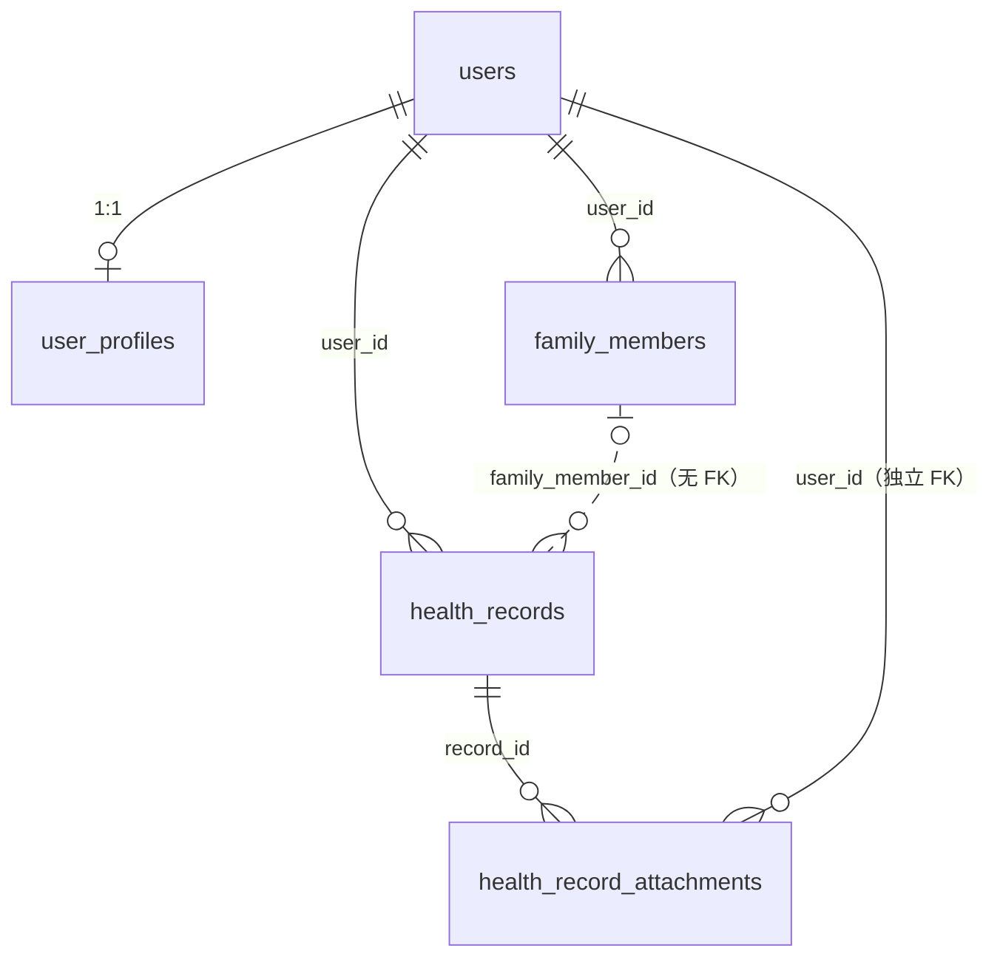
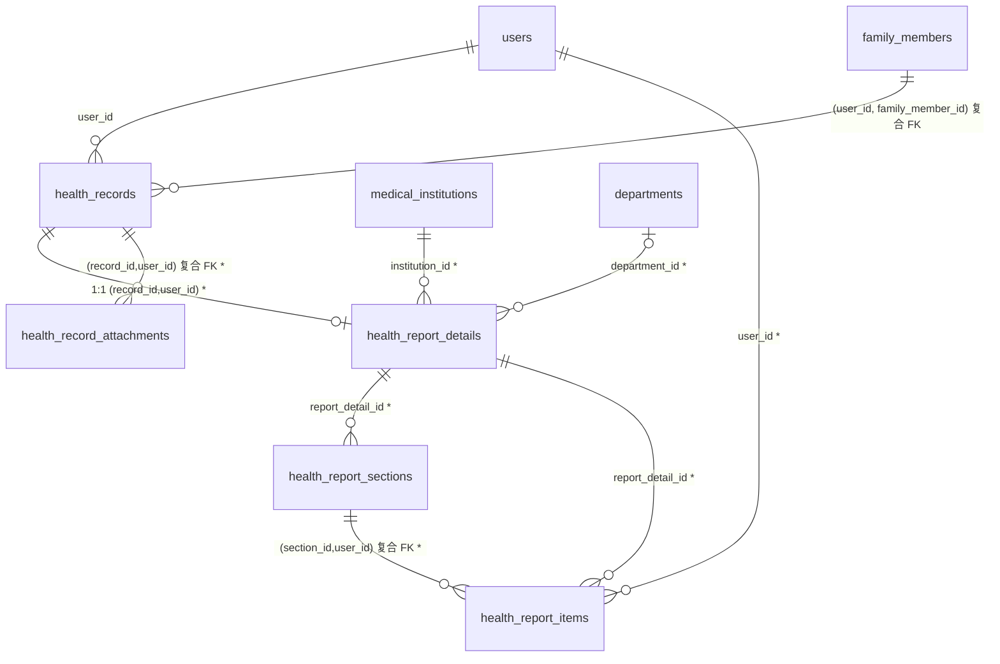

# wechar 数据库架构优化与检查报告数据体系 · 交付报告

> 日期：2026-11-05 · 环境：本机 dev（MySQL 8.0.41 / `wechar_dev`），未部署、未提交 Git、未改 8088 端口及其配置。
> 数据采集口径：`information_schema` 只读查询 + Flyway 历史 + 启动后 HTTP 实测 + 单元/契约/门禁实跑。
> **报告中所有「通过」均指本轮实际执行过的命令或请求；未执行项在 §15 明确列出，不写「通过」。**
> 原始证据：`backend/deploy/DB_AUDIT_20261105.md`、`backend/deploy/DB_SCHEMA_DESIGN_20261105.md`、
> `artifacts/db-doc/acceptance-db-20261105.txt`、`artifacts/db-doc/pending-detail.json`、
> `artifacts/db-doc/report-list-c.json`。

---

## 0. 结论摘要

| 项 | 结果 |
|---|---|
| 结构 | V27 新增 4 表 + 健康档案/附件表扩展 + 组合索引 + 复合外键；真实库 Flyway `success=1` |
| 数据 | 新增 3 个演示患者、13 条档案（7 份报告 + 6 条非报告类）、7 份报告详情、8 分组、27 项目、3 模拟机构 |
| 门禁 | 后端统一状态门禁；PENDING/REVIEWING 不返回明细/结论/附件，越权 404（HTTP 实测） |
| 接口 | 新增 `GET /api/v1/reports`、`GET /api/v1/reports/{recordId}`，已写入 OpenAPI 契约 |
| 页面 | 新建报告列表页与报告详情页（原生 WXML/WXSS/JS），接入「我的 → 报告查询」原占位入口 |
| 保护 | 原 4 个基础演示账号字段与改造前基线逐字段一致（SAME ×4），原 7 条档案 7→7 |
| 测试 | Java 319/319、网关 132/132、前端单测 14/14、`check-project` 全通过、HTTP 15 项符合预期 |

**与任务书的基线偏差（重要）**：任务书称「生产迁移到 V26、开发种子到 V9009，V27/V9010 未占用」，
但仓库实际**已存在未提交、未应用的 `V28__resource_asset_catalog.sql`**（2026-11-05 由
`tools/resource-import.py` 生成，126 条带 WHERE 的资源元数据 UPDATE）。本次服务启动时
Flyway 按顺序自动应用了它（rank 39）。该文件非本轮编写、未被修改，属既有演进。

---

## 1. 原数据库结构审计报告

详见 `backend/deploy/DB_AUDIT_20261105.md`（阶段 01，17 项论断核验）。实测结论：

| 论断 | 核验结果 |
|---|---|
| 报告数据集中在 `summary` 一段文字，附件表 0 行 | 成立。7 条档案中 EXAM 3 条，`health_record_attachments` 0 行 |
| 不宜推倒重建、应渐进扩展 | 采纳。`health_records` 保留为主表 |
| `health_records.family_member_id` 无物理外键 | 成立；V27 前无 `UNIQUE(id,user_id)`，复合外键会直接失败 |
| 附件 `record_id` / `user_id` 双独立外键不保证同属一用户 | 成立 |
| 任务书建议索引 `(user_id, category, recorded_at)` | **不成立**：`HealthRecordRepository.list` 实际按 `user_id + family_member_id` 过滤、按 `recorded_at,id` 排序，无 `category` 条件；改为 `idx_hr_user_family_time` |
| 全库约 6 MiB / 7,878 行 | 行数准确；空间实测 DATA 2.50 MiB + INDEX 4.94 MiB = **7.44 MiB** |
| 新增 3 演示账号可登录 | 阶段 01 时**不成立**（dev provider 只产 2 个 openid）；阶段 05 已用显式映射修复并实测通过 |

备份：`.trash/db-backup-20261105/pre-report-audit-20261105.sql`（1.7 MB / 36 表 / mysqldump exit=0）。

---

## 2. 问题与风险清单

| # | 问题 | 影响 | 本轮处置 |
|---|---|---|---|
| P0-1 | 报告无结构化项目/数值/单位/参考区间 | 无法出电子报告 | V27 三张明细表 + DECIMAL 数值列 |
| P0-2 | 未审核结果可能经旧 `/health-records` 读出 | 医疗数据泄露 | `PatientService` 与 `HealthReportService` 共用 `isUnpublishedReport` 门禁 |
| P0-3 | 复合外键缺前置唯一索引 | DDL 直接失败 | V27 先补 `uq_health_records_id_user` / `uq_family_members_user_id` |
| P1-1 | 新演示用户无登录通道 | 数据不可达、无法验收 | dev-only `identity-map`（仍受 X-Dev-Login-Key + 白名单约束） |
| P1-2 | 演示家属 `proxy_status=NONE` 导致切换 404 | 家庭成员验收失败 | 新增 V9011 单行幂等修正为 `GRANTED` |
| P1-3 | V27 含 MySQL 专有 DDL，H2 无法解析 | 245 项单测上下文连带失败 | itest/prodtest 档 Flyway `target=26`；见 §15 技术债 |
| P2-1 | 资源文件被压缩后测试写死指纹 | `ResourceAssetTest` 1 项转红 | 改为从磁盘文件/库内登记值动态取，断言强度不变 |
| P2-2 | 报告列表 SQL 有 filesort | 7 行数据无实绩影响 | 未消除，见 §8 / §15 |
| P2-3 | 机构主数据双轨 | 名称可能漂移 | 双轨并存、只插模拟机构；映射待业务确认 |

---

## 3. 优化前后 ER 关系图

**改造前（健康档案域）**

**改造后（V27 新增部分以 `*` 标注）**

---

## 4. 新增数据表及字段说明

设计定稿见 `backend/deploy/DB_SCHEMA_DESIGN_20261105.md` §2；DDL 见 V27。

| 表 | 关键字段 | 说明 |
|---|---|---|
| `medical_institutions` | `institution_code/name/type/hospital_level/address/telephone/status/is_demo` | 模拟机构目录；不改 `departments.hospital_name` 与 `health_records.hospital` |
| `health_report_details` | 1:1 `record_id`；`report_no/report_type`；患者快照 3 列；门诊/住院号；标本 4 列；`collection/received/tested/reported_at`；`operator/reviewer_name`；`findings/impression/conclusion/recommendation_text`；`data_origin/external_report_id/is_demo/demo_notice` | **刻意不复制**主表 `category/title/summary/hospital/report_status` |
| `health_report_sections` | `report_detail_id,user_id,section_code,section_name,sort_order` | 分组只承载展示顺序 |
| `health_report_items` | `result_value DECIMAL(18,4)`、`result_text VARCHAR(1000)`、`reference_low/high DECIMAL(18,4)`、`reference_text`、`abnormal_flag`、`unit`、`sort_order` | 数值/定性/描述三型并存；参考区间为**报告快照**，非全局标准 |
| `health_record_attachments`（扩展） | `attachment_type,display_name,sort_order,preview_object_key` | 二进制仍不入库 |

新定义枚举（本轮新增，未冒充既有契约）：`abnormal_flag` = NORMAL/HIGH/LOW/POSITIVE/NEGATIVE/ABNORMAL/NOT_APPLICABLE；
`report_type` = LAB/IMAGING/CHECKUP/PATHOLOGY/ECG；`data_origin` = DEMO/EXTERNAL/MANUAL。

---

## 5. 新增 Flyway 迁移脚本

| 文件 | 位置 | 状态 |
|---|---|---|
| `V27__health_report_structure.sql` | `db/migration` | rank 37，`success=1`（16:11:07） |
| `V28__resource_asset_catalog.sql` | `db/migration` | **既有文件、非本轮编写**，rank 39 `success=1`（16:59:12） |
| `V9010__health_report_demo_seed.sql` | `db/dev` | rank 38 `success=1`（16:11:07） |
| `V9011__demo_family_proxy_grant.sql` | `db/dev` | rank 40 `success=1`（16:59:12） |

未修改任何已应用的 V1~V26 / V9000~V9009，未改 `flyway_schema_history`、未动 checksum。
V27 按任务书进 `db/migration`（生产会建空表），演示种子仅 `db/dev` 加载。

---

## 6. 演示数据种子脚本

- `backend/business-service/src/main/resources/db/dev/V9010__health_report_demo_seed.sql`（37.9 KB，固定主键 + `ON DUPLICATE KEY UPDATE pk = pk` 幂等）。
- 生成器 `tools/gen-report-demo-seed.py`（可复现，改生成器后需同步重新生成并留意已应用文件的 checksum）。
- 数据全部带「演示」标识；机构名含「模拟」，报告号 `DEMO-*`，结论自带「不构成诊断依据」；无真实患者、真实医生签名、公章或二维码。
- 幂等测试：沙箱库 `wechar_drill_20261105_v2` 连续两次应用 V9010 均 `exit=0`，行数不增。
- 负向测试：跨用户附件、跨用户家属档案均触发 `ERROR 1452`（复合外键生效）。

---

## 7. 新增用户与报告数据分布统计

实测（`acceptance-db-20261105.txt`）：

| 项 | 改造前 | 改造后 |
|---|---|---|
| 用户 | 4 | **7**（原 4 + 演示甲乙丙 3） |
| `health_records` | 7 | **20**（原 7 + 新 13） |
| 报告（EXAM） | 3（全 READY，含摘要） | 原 3 + 新 7 = 10 |
| 新增报告状态 | — | READY **5** / REVIEWING **1** / PENDING **1** |
| 非报告类新增 | — | 6 条，`report_status = NULL`（VITALS/ALLERGY/MEDICATION/HISTORY） |
| 报告详情 / 分组 / 项目 | 0 | **7 / 8 / 27** |
| 模拟机构 | 0 | 3 |
| 异常项目分布 | — | NORMAL 21 / HIGH 3 / NEGATIVE 2 / ABNORMAL 1（无危急值） |
| 附件行 | 0 | 0（见 §15） |

患者分布：甲 血常规 + 肝肾功能 + 腹部超声（3 READY）+ 家属血压记录；
乙 尿常规 + 年度体检（2 READY）；丙 心电图 REVIEWING + 胸部影像 PENDING。
**与任务书的偏差**：任务书要求「演示用户 C 拥有一份已完成的检查报告」，本轮 C 只有 2 份未出具报告
（总份数 7 与 READY5/REVIEWING1/PENDING1 的全局分布一致）。见 §15。

---

## 8. 外键、唯一键及组合索引检查结果

| 检查 | 实测 |
|---|---|
| 4 张新表 | 4/4 存在，InnoDB + `utf8mb4_unicode_ci` |
| 报告相关外键 | 12 条（含原有附件表外键，统计口径 `fk_hr%` + `fk_health_records_family`） |
| 完整性违例 | 无主详情 0、跨用户详情 0、无归属项目 0、跨用户家属档案 0、时间先后违例 0、未审核报告项目 **0** |
| `health_records` 索引 | 6 个（含 V27 新增 2 个组合索引 + 1 个复合外键前置唯一键） |
| EXPLAIN：真实档案列表 | 走 `idx_hr_user_family_time`，`Backward index scan`，**filesort 已消除**（改造前为 `Using filesort`） |
| EXPLAIN：报告列表 | `Using temporary; Using filesort`（跨表 `COALESCE(d.reported_at, r.recorded_at)` 排序无法用索引）；试过改按 `r.recorded_at` 排序与 `STRAIGHT_JOIN`，仍带 filesort |
| N+1 | 报告列表 1 条 SQL；详情 4 条（详情/分组/项目/附件），`HealthReportRepository` 共 4 处 `jdbc.query`，无循环内查询 |

按任务书「不要为增加索引数量而盲目建立索引」，7 行数据量下**未**再加 `(user_id, recorded_at, id)` 索引。

---

## 9. 后端接口修改清单

| 文件 | 改动 |
|---|---|
| `patient/HealthReportRepository.java` | 新增：列表/详情/分组/项目 4 个查询，全部带 `user_id`；动态拼固定条件片段、值全参数化 |
| `patient/HealthReportService.java` | 新增：读模型、状态门禁 `isUnpublishedReport`、异常中文标签、时间/枚举校验 |
| `patient/HealthReportController.java` | 新增：`GET /api/v1/reports`、`GET /api/v1/reports/{recordId}`（独立控制器，不动既有构造签名） |
| `patient/dto/Report{Summary,Detail,Section,Item}Data.java` | 新增 4 个 DTO |
| `patient/PatientService.java` | `toRecord` / `listAttachments` 接入同源状态门禁 |
| `auth/DevWechatSessionProvider.java` | 新增 dev-only `identity-map`；未命中映射时原两账号行为不变 |
| `application.yml` | dev 档新增 `app.auth.dev-login.identity-map`（生产/itest 档无此键 → 空映射） |
| `contracts/business-openapi.yaml` | 新增 2 个 path + 6 个 schema；`pyyaml` 校验 91 paths / 171 schemas |
| `src/test/resources/application-{itest,prodtest}.yml` | H2 档 Flyway `target: 26`（见 §15） |
| `src/test/java/.../M4MigrationDrillTest.java` | 阶段 2/3 演练 target=26 |
| `src/test/java/.../ResourceAssetTest.java` | 陈旧硬编码指纹改为与被测对象同源 |

---

## 10. 小程序页面修改清单

| 文件 | 改动 |
|---|---|
| `config/api.js` | 新增 `REPORT_LIST` / `REPORT_DETAIL` 并导出 |
| `services/user.js` | 新增 `listReports` / `getReport` 并导出；**不使用 withFallback 演示兜底** |
| `app.json` | 注册 `pages/profile/reports/reports`、`pages/profile/report-detail/report-detail` |
| `pages/profile/profile.wxml` / `.js` | 原「报告查询」占位入口改跳新列表页 |
| `pages/profile/reports/*` | 新建：分类 tab、状态/就诊人/起止日期筛选、报告卡（机构/编号/科室/时间/状态/异常项目数）、演示标记、错误态、骨架屏 |
| `pages/profile/report-detail/*` | 新建：九段式报告版式、分组折叠、异常文字清单、结论/所见、附件预览、演示水印、未出具状态锁 |

样式铁律：图标全部取自 `utils/icons.js`、无 emoji、色值仅用 `app.wxss` 变量（除 `#FFFFFF`）、
字号仅用 `--font-*`、页面无 `wx.request`、≥600px 断点所有 rpx 选择器 ÷2 折 px、含 `max-height:800px` 矮屏适配。
`check-project` ①~⑥ 全通过（图标 185 处引用有效、禁址 0 命中、主包 1.326 MB、主包图片+音频 184.5 KB）。

---

## 11. 数据隔离及权限测试结果（HTTP 实测，2026-11-05 16:59 启动会话）

| # | 用例 | 结果 |
|---|---|---|
| 1 | 原账号 `13800138001` 登录 | 200，`u-dev-user-1` |
| 2 | 新演示甲 `13800138011` 登录 | 200，`u-v9010-patient-a` |
| 3 | 新演示丙 `13800138013` 登录 | 200，`u-v9010-patient-c` |
| 4 | 未登记手机号 `13900000000` 登录 | **401**（白名单未放开） |
| 5 | 甲报告列表 | 3 份，按时间倒序 `10-25 / 10-22 / 10-20` |
| 6 | 甲 `reportType=LAB` / `status=READY` | 2 份 / 3 份 |
| 7 | READY 报告详情 | 1 分组 / 6 项目 / 结论 119 字 |
| 8 | PENDING 报告详情 | `sections=0`、结论/所见全 `null`、中文 `statusNotice` 正确 |
| 9 | 甲访问丙的报告 / 丙访问甲的 READY 报告 | 均 **404** |
| 10 | 原账号报告列表 | 0（原档案无明细，未被污染） |
| 11 | 原账号 `/health-records` | 7 条（原档案完好） |
| 12 | 旧接口读 PENDING 档案 `summary` | 空（门禁同源生效） |
| 13 | 旧接口读 PENDING 附件 | 0 条 |
| 14 | 甲切换家属 `fm-v9010-patient-a-child` | 200，1 条（V9011 已授权） |
| 15 | UTF-8 中文复核（curl 落盘 + Python 读） | `报告待出结果，检查结果暂不展示`，`demoNotice` 正常 |

> PowerShell `Invoke-RestMethod`（PS 5.1 按 Latin-1 解码）显示中文为乱码，属**显示层**问题；
> 已用 `curl.exe` 落盘原始 UTF-8 响应二次复核，后端字节正确（`artifacts/db-doc/pending-detail.json`）。

---

## 12. 数据库迁移测试记录

| 阶段 | 记录 |
|---|---|
| 只读预演 | 前置唯一索引 0/0、孤儿家属档案 0、附件跨用户 0、EXPLAIN 三条 SQL |
| 沙箱演练 | 独立库 `wechar_drill_20261105` / `_v2`：从全库备份基线导入 → V27 → V9010 全 `exit=0` |
| 幂等 | V9010 连续两次应用，行数不增 |
| 负向 | 跨用户附件 / 跨用户家属档案均 `ERROR 1452` |
| 真实库 | Flyway rank 37/38/39/40 全 `success=1`；DDL 隐式提交已用备份恢复点兜底 |
| 单测 | `mvnw -o test` **319/319**（首次 245 errors 由 V27 H2 不兼容引起，定位并修正后全绿） |
| 网关 | `pytest -q` **132 passed** |
| 前端 | `node tools/test-fe.js` **14/14**；`node tools/check-project.js` 全通过 |
| 契约快照 | `tools/contract-snapshot.js` **未执行**（需运行态 `--token`，会话结束服务已回收；本轮未改其覆盖的 5 个端点） |

---

## 13. 旧演示账号保护前后对比

对比对象：真实库 `wechar_dev.users` vs 演练库 `wechar_drill_20261105_v2.users`（后者由
`pre-report-audit-20261105.sql` 基线导入，即改造前状态）。

| id | wechat_openid | status | phone_hash（前 12）改造后 / 基线 | 结论 |
|---|---|---|---|---|
| `u-dev-user-1` | `dev-user-1` | ACTIVE | `b0da6e942b8a` / `b0da6e942b8a` | SAME |
| `u-dev-user-2` | `dev-user-2` | ACTIVE | `b38646717153` / `b38646717153` | SAME |
| `u-dev-user-3` | `dev-user-3` | ACTIVE | `982246146fed` / `982246146fed` | SAME |
| `u-dev-user-fresh-9` | `dev-user-fresh-9` | ACTIVE | NULL / NULL | SAME |

原健康档案：基线 7 条 → 真实库 7 条。原预约/问诊/消息/审计记录未执行任何 DELETE/UPDATE/TRUNCATE。

---

## 14. 数据库备份位置和恢复方案

| 备份 | 路径 | 说明 |
|---|---|---|
| 改造前全库 | `.trash/db-backup-20261105/pre-report-audit-20261105.sql` | 1.7 MB / 36 表 / `mysqldump --single-transaction` / exit=0 |
| 治理前影响表 | `.trash/db-backup-20261105/affected-tables.sql`、`full-before-batches.sql` | 11-05 上午治理批次留档 |
| 演练基线 | `artifacts/db-doc/drill_base.sql` | 供独立库复现 V27/V9010 |
| 演练库 | `wechar_drill_20261105`、`wechar_drill_20261105_v2` | 独立于业务库，未清理 |

恢复：DDL 隐式提交不能事务回滚；如需回退，先停服务，用
`mysql -u root wechar_dev < .trash/db-backup-20261105/pre-report-audit-20261105.sql` 重建到恢复点，
再删除本轮 4 个迁移文件并重新打包（**会丢失期间全部新增业务数据，须业务确认**）。
或新增 `V29` 显式 DROP 新表/索引/列，保留账号与历史数据。

---

## 15. 当前尚未解决的问题（如实列示）

| # | 项 | 状态 / 建议 |
|---|---|---|
| 1 | **V27 用了 MySQL 专有 DDL**（多列 `ADD COLUMN` + `ADD KEY`），H2 无法解析 | 本轮以 itest/prodtest `spring.flyway.target=26` 绕开；长期应把 V27 拆成通用 DDL 的新迁移并同步 checksum，或为 H2 提供专用迁移目录。**技术债** |
| 2 | 报告列表 SQL 仍 `Using filesort` | 7 行数据无实绩影响；若报告量上来，新增 `(user_id, recorded_at, id)` 或按 `family_member_id` 分组查询后再评估 |
| 3 | 演示用户丙缺 1 份 READY 报告 | 与任务书 §五「用户 C：已完成的检查报告」不符；需新种子迁移补 1 份，或业务确认接受当前全局分布 |
| 4 | `health_record_attachments` 仍 0 行 | 按「文件真实存在且 MIME/大小/SHA-256 校验通过才登记」的约束，本轮**不造假文件**；影像附件预览代码已实现但无真实文件可验 |
| 5 | `medical_institutions` 与 `departments.hospital_id` 双轨 | 映射关系待业务确认；本轮未批量替换任何现有医院名 |
| 6 | **前端未做真机视觉复核** | 仅通过门禁与静态检查；记忆铁律「门禁全绿 ≠ 能看」，需在微信开发者工具实机核对 13.2 英寸 Pad 与常见手机宽度 |
| 7 | AI 服务链路未验证 | 两次启动均带 `-SkipAI`；未执行「不影响 AI 服务」的实测，仅未改其代码 |
| 8 | 兼容性回归范围 | 原登录/预约/问诊/消息由 319 项单测 + 原账号登录实测覆盖，未逐接口做 HTTP 回归 |
| 9 | 契约快照未执行 | 需运行态 token，见 §12 |
| 10 | 状态门禁口径 | 仅对 `PENDING/REVIEWING` 脱敏；`report_status=NULL` 按契约视为「非报告类/未知」不脱敏（为兼容存量 EXAM 档案与 M9 附件用例） |
| 11 | V28 资源对账迁移 | 既有文件在本次启动被应用（126 条带 WHERE 的元数据 UPDATE），非本轮编写；建议单独复核资源清单 ETag 一致性 |
| 12 | 历史遗留 | `PARENT`/`relation` 语义归一、法务保留周期、HIS 主数据、`^ik-` 联调数据清理口径，沿用上午治理结论，未在本轮处理 |

---

## 附：数据来源索引

| 章节 | 来源 |
|---|---|
| §1 §14 | `DB_AUDIT_20261105.md`、备份文件、`information_schema` 只读查询 |
| §3 §4 | `DB_SCHEMA_DESIGN_20261105.md`、`V27__health_report_structure.sql` |
| §5 §6 §12 | `flyway_schema_history`、沙箱演练日志、Maven/pytest/Node 实跑输出 |
| §7 §8 §13 | `artifacts/db-doc/acceptance-db-20261105.txt`、跨库 SELECT |
| §9 §10 | 本轮新增/修改文件清单、`check-project` / `test-fe` 输出 |
| §11 | 2026-11-05 16:59 / 17:03 两次启动会话的 HTTP 实测、`pending-detail.json`、`report-list-c.json` |
