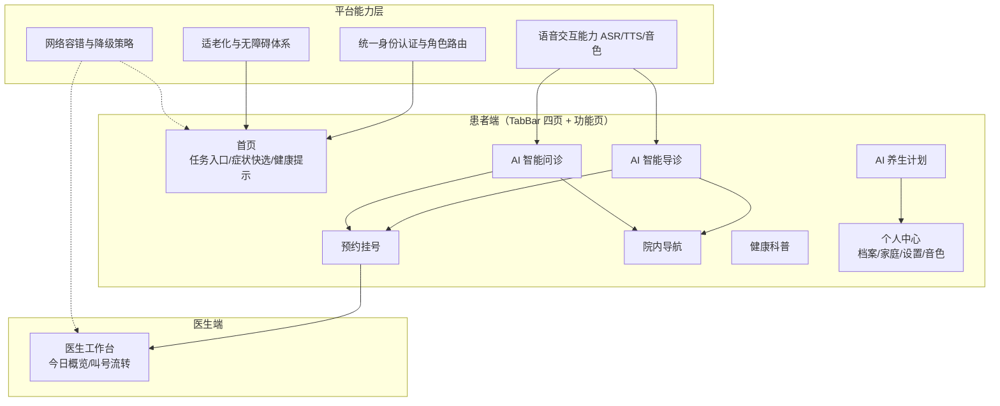
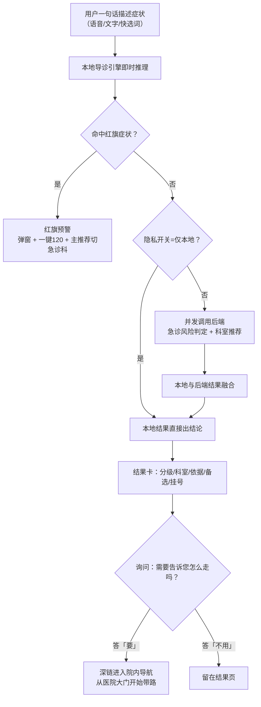
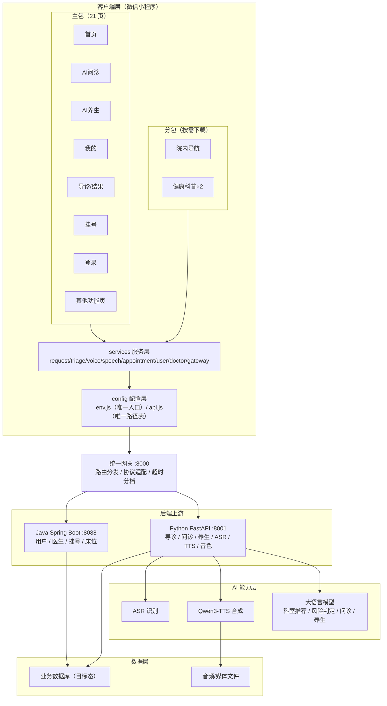
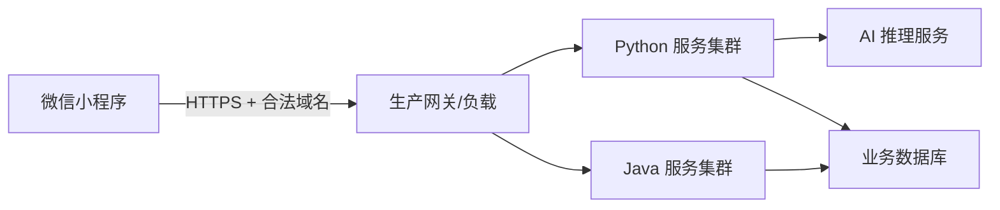
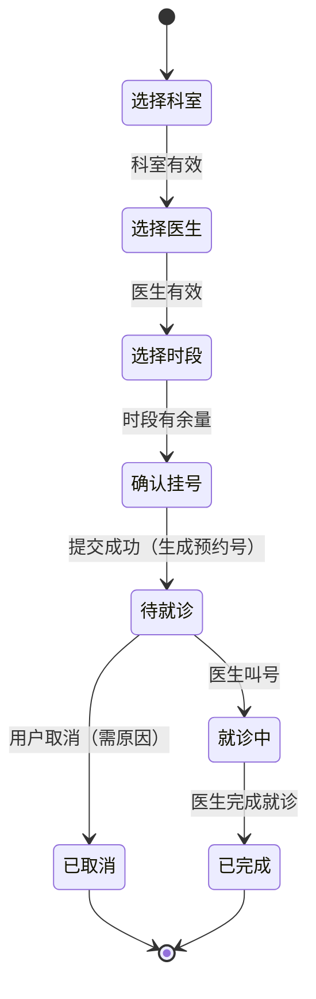
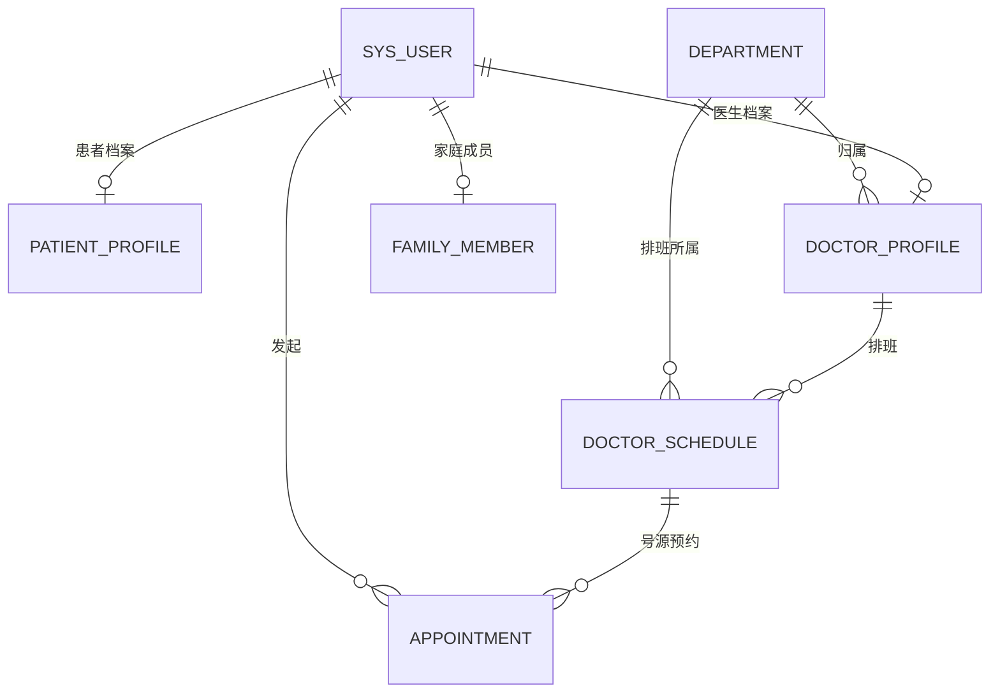
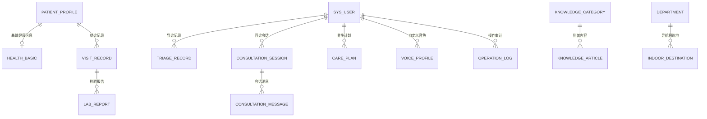

# 医疗健康 AI 微信小程序 · 项目介绍文档

| 项 | 内容 |
| --- | --- |
| 文档名称 | 医疗健康 AI 微信小程序项目介绍文档 |
| 文档版本 | V1.0 |
| 编写日期 | 2026-10-14 |
| 项目代号 | 康诊云（患者端 AI 助手「小安」） |
| 目标读者 | 项目干系人（产品/运营/管理）、开发团队（前端/后端/测试/AI） |
| 文档定位 | 面向全干系人的总体介绍与技术需求说明，不包含任何具体代码实现 |

---

## 一、文档概述

### 1.1 编写目的

本文档系统性地介绍「医疗健康 AI 微信小程序」项目的背景与目标、核心功能模块、系统架构，并明确后端功能需求（接口定义、业务逻辑规则、性能与安全要求）与数据库设计需求（数据模型、表结构关系、存储约束与索引策略）。目的在于：

1. 让非技术干系人快速理解项目价值、范围与边界；
2. 让开发团队在统一的业务语言与技术契约下协作；
3. 作为后续概要设计、详细设计、测试验收与项目演进的基准文档。

### 1.2 目标读者与阅读建议

| 读者角色 | 建议重点阅读章节 |
| --- | --- |
| 项目管理者 / 产品经理 | 第二、三章，第五章业务逻辑规则，第八章 |
| 前端开发 | 第三、四章，第五章接口定义 |
| 后端开发 | 第四章，第五章全文，第六章全文 |
| 测试工程师 | 第三章功能描述，第五章业务规则，第七章 |
| AI 算法工程师 | 第三章导诊/问诊/养生模块，4.4 节，5.3 节 |

### 1.3 文档范围与边界

**范围内**：患者端与医生端微信小程序、统一网关后端服务、AI 能力层（导诊/问诊/养生/语音）、目标态持久化数据模型。

**范围外**（明确不做或另立文档）：

- 医院内部 HIS/EMR 等既有系统的改造与对接细节；
- 微信支付、医保结算等资金链路；
- 已下线的能力：手势识别挂号、Live2D 数字人（2026-09-13 起前端不再引用，相关页面/服务已删除）。

### 1.4 术语约定

| 术语 | 含义 |
| --- | --- |
| 导诊 | 根据用户口语化症状描述，推荐就诊科室并给出紧急程度分级的能力 |
| 红旗症状 | 提示高危、需立即就医的症状特征（如胸痛、意识障碍等） |
| 问诊 | 用户与 AI 的多轮/单轮健康咨询交互 |
| 养生计划 | 面向特定年龄段输出的膳食、睡眠、运动等生活建议方案 |
| TTS / ASR | 语音合成 / 语音识别 |
| 网关 | 后端统一入口服务，负责路由转发与协议适配 |
| 主包 / 分包 | 微信小程序的启动包与按需下载子包 |
| 适老化 | 面向中老年用户的字号、对比度、交互简化设计体系 |
| RBAC | 基于角色的访问控制（患者/医生/管理员） |

### 1.5 图示说明

本文档图示采用 Mermaid 文本图示语法绘制（架构图、状态机图、ER 图等），可在支持 Mermaid 的 Markdown 环境中直接渲染；纯文本环境下亦可作为结构化说明阅读。全文不包含任何编程代码实现。

---

## 二、项目背景与目标

### 2.1 行业背景与问题痛点

随着 AI 大模型在医疗健康领域的纵深应用，用户对「随时随地获得就医指导」的需求快速增长。但当前面向 C 端的医疗类小程序普遍存在四类突出问题：

1. **入口 App 化，老人不会用**：功能以「智能问诊 / AI 养生 / 语音按钮」等术语堆叠成功能菜单，用户需要先理解系统，才能使用系统；
2. **医患角色不清**：患者与医生权限边界模糊，或被迫维护两套独立小程序，成本高、体验割裂；
3. **适老化不等于无障碍**：仅做到「字体大、按钮大、对比高」，缺乏语音替代、状态播报、防误触、错误可恢复等完整的无障碍交互体系；
4. **后端地址与端口强耦合**：页面直连具体 IP 与端口，后端一迁移前端就要改代码、重新发版。

与此同时，我国中老年网民规模持续扩大，这一人群恰恰是就医频次最高、数字技能最弱的群体。「让老人少看字、少输入、少操作，通过说话即可完成健康服务」成为明确的产品机会。

### 2.2 项目定位

> **本项目不是「一个拥有很多医疗功能的小程序」，而是「面向中老年及视觉辅助用户的 AI 语音医疗服务入口」。**

产品核心主张：

- **能说不打字，能选不输入，能一步不两步**；
- 用户不需要学习软件，而是让系统理解用户；
- 重要信息同时提供「视觉 + 文字 +语音」三种载体，颜色绝不作为唯一信息载体。

产品参考并融合了四类标杆经验：成熟医院级小程序的 UI 标准（沉稳医疗配色、卡片化布局）、AI 养生助手（体质辨识与节气调理）、大屏投屏问诊架构、以及公众健康服务平台的导诊就医引导思路。

### 2.3 建设目标

**业务目标**：

1. 打通「说一句话 → AI 理解 → 导诊/问诊/养生 → 挂号/导航」的核心服务闭环；
2. 建立患者端、医生端统一身份与权限体系，一套代码双工作台；
3. 建立统一网关入口，前端与后端地址、端口彻底解耦。

**用户目标**：

1. 老年用户无需培训即可完成「说自己不舒服 → 知道去哪个科 → 怎么走」的全流程；
2. 核心操作 100% 可语音完成，关键状态可听、可感、可恢复；
3. 全界面支持三档字号与高对比度，动画减弱，防误触。

**技术目标**：

1. 前端锁定原生微信小程序技术栈，包体严格受控（主包 ≤ 2MB）；
2. 后端统一网关单入口，路由规则清晰，AI 长任务分档超时；
3. AI 结果本地引擎与后端模型双路融合，红旗症状本地优先，确保安全底线；
4. 为未来 HarmonyOS 迁移预留稳定的设计令牌、API 契约与数据模型。

### 2.4 产品设计原则

| # | 原则 | 说明 |
| --- | --- | --- |
| 1 | 老人不用学习这个软件 | 交互以「我要看病 / 我要咨询 / 我要养生」等任务语言组织，而非系统术语 |
| 2 | 让系统理解用户 | 口语化输入直接理解，不把用户困在多轮问答里 |
| 3 | 能语音，不要求打字 | 语音是第一输入入口，同时提供可点选的症状快选词 |
| 4 | 能一步完成，不设计两步 | 导诊一句话直接出科室；问诊一句话直接出结果卡 |
| 5 | 重要信息三通道呈现 | 视觉 + 文字 + 语音同时送达 |
| 6 | 颜色不是唯一信息载体 | 状态必须配图标与文字（如「⚠ 高风险：建议立即就医」） |
| 7 | AI 等待不表现为卡顿 | 长任务必须展示阶段进度（理解中 → 分析中 → 生成中） |
| 8 | 前端永不绑定具体端口 | 前端只认统一网关地址，端口变化只改网关配置 |
| 9 | 医患共享基础架构、分设工作台 | 权限由后端真正控制，前端隐藏按钮不等于安全 |
| 10 | 小程序做到极致再考虑迁移 | 提前固化 Design Token、API Schema、数据模型与状态机 |

### 2.5 建设范围与阶段规划

| 阶段 | 范围 | 状态 |
| --- | --- | --- |
| 第一阶段 | 患者端高完成度：导诊、问诊、养生、挂号、导航、科普、语音、适老化 | 已完成（当前 V1.19） |
| 第二阶段 | 医生工作台：今日概览、挂号叫号、状态流转、患者档案 | 已交付，持续联调 |
| 第三阶段 | 统一网关收敛全部后端服务，端口治理，HTTPS 生产化 | 进行中 |
| 第四阶段 | 基于已固化的设计令牌 / API / 数据模型迁移 HarmonyOS | 规划 |

### 2.6 干系人角色

| 角色 | 关注点 |
| --- | --- |
| 患者用户（核心） | 少操作、听得懂、看得清、不害怕 |
| 医生用户 | 工作台效率、叫号流转、患者信息完整 |
| 产品经理 | 需求闭环、体验一致性、内容合规 |
| 前端团队 | 包体、性能、兼容性、组件复用 |
| 后端团队 | 接口契约、网关路由、状态机、数据一致性 |
| AI 团队 | 导诊准确率、红旗召回、TTS 音质、推理时延 |
| 运维 / 安全 | 隧道与域名、HTTPS、脱敏、备份 |

---

## 三、核心功能模块

### 3.0 功能架构总览

小程序整体由 **主包 21 个页面**（含登录、患者端 TabBar 四页、导诊、挂号、个人中心各页与医生工作台）与 **2 个分包**（院内导航 1 页、健康科普 2 页）构成，全部能力构建在上述平台能力层之上。

### 3.1 统一身份认证与角色路由

**目标**：一套小程序、一个统一身份系统，登录后按角色自动分流至患者端或医生端，权限由后端真正控制。

**主要功能**：

1. 双身份登录入口：患者（手机号 + 密码，支持一键入口）与医生（工号 + 密码）；
2. 登录态本地持久化 72 小时（记录登录时间戳），冷启动在有效期内自动恢复并跳过登录页，超期自动清除；
3. 角色路由：患者 → 患者端 TabBar（首页/AI 问诊/AI 养生/我的）；医生 → 重启动进入医生工作台（工作台页面具备鉴权拦截，未授权访问被引导回登录）；
4. 权限边界：患者即使手动构造医生接口地址，后端也必须返回 403；前端任何角色判断只控制「显示什么」，不控制「能访问什么」。

### 3.2 患者端首页

**目标**：让用户进门就知道「我要做什么」，以任务语言组织入口。

**主要功能**：

1. AI 助手问候区：小安头像 + 动态问候语，一问一答即可进入导诊；
2. 四宫格核心任务：智能问诊 / 预约挂号 / AI 养生 / 报告查询；
3. 导诊 Banner：插画 + 一句话入口，直达智能导诊；
4. 八宫格常用服务：覆盖高频功能直达；
5. 症状快选词：点击预填症状文本并自动进入导诊、直接出结论（长者不必打字）；
6. 健康提示横滑卡：3 个提示视频入口（主包内仅展示图标与文字，视频本体位于分包）；
7. 全部健康科普入口、预约动态卡、投屏连接状态。

首页是全部内容与去向的集中配置点，页面模板不书写跳转路径，保证入口可维护、可审计。

### 3.3 AI 智能导诊

**目标**：回答「我现在应该去哪里看？」，一句话直接给出科室与紧急程度。

**主要功能**：

1. 语音 / 文字双输入，支持首屏可点症状示例；
2. 本地导诊引擎即时推理（0ms 级响应）：症状词加权 + 部位兜底校正 + 红旗判定 + 分级；
3. 后端 AI 融合：急诊风险判定 + 科室推荐，与本地结果取并集；
4. 结果卡：紧急程度分级、推荐科室、推荐依据、备选科室、挂号入口；
5. 红旗预警：本地优先，命中即弹窗警示 + 一键 120 + 主推荐切换急诊科；
6. 路线询问：「需要我告诉您去「XX」怎么走吗？」——答「要」即深链进入院内导航并自动带路；
7. 隐私开关：选择「仅本地分析」时零后端调用。

**关键流程**：

### 3.4 AI 智能问诊

**目标**：回答「我到底是什么情况？」，进门一句话、回一句话即出结果。

**主要功能**：

1. TabBar 一级入口，固定开场白引导用户开口；
2. 用户回一句 → 直接分诊出结果卡（分级 / 科室 / 依据 / 备选 / 挂号），不把用户困在多轮追问中；仅当完全识别不出归属时补问一次，且一次只问一个问题；
3. 与导诊共用同一套导诊引擎与服务层，两条入口业务口径一致；
4. 红旗症状：红色警示条 + 拨 120 + 弹窗；
5. 消息列表增量更新（每次只推送新增消息，设 60 条上限），保证长会话不卡顿；
6. 降级策略：后端不可用时本地引擎兜底，且不混入任何伪造数据。

### 3.5 AI 养生计划

**目标**：回答「平时应该怎么养？」，输出简短、可执行、可朗读的生活建议。

**主要功能**：

1. 中医体质辨识测评与重新测评；
2. 二十四节气养生提示；
3. 三天养生方案：按日输出膳食、睡眠、运动三个维度；
4. 方案支持语音朗读、投屏到大屏；
5. 养生计划由后端大模型生成（耗时约百秒级），前端采用专用长超时与阶段进度反馈。

### 3.6 预约挂号

**目标**：从「知道去哪个科」到「拿到预约号」一步贯通。

**主要功能**：

1. 五步状态机：选择科室 → 选择医生 → 选择时段 → 确认 → 完成；
2. 科室列表与导诊推荐联动（导诊结果卡可直接带科室进入挂号）；
3. 号源按时段管理（工作日上下午分段，每 30 分钟一个时段）；
4. 主诉输入（可选，可从导诊症状带入）；
5. 提交生成预约号，写入本地缓存，挂号记录页合并展示；
6. 医生端可对预约执行「叫号（就诊中）→ 完成就诊（已完成）」状态流转；
7. 异常状态完备：医生已满、科室无医生、网络失败均有中文可恢复提示。

### 3.7 院内导航

**目标**：回答「我到了医院接下来怎么走？」，从医院大门开始把用户带到诊室门口。

**主要功能**：

1. 1F 平面图底图 + 路径 + 标记同层 Canvas 渲染，自研平移/缩放手势；
2. 起点固定为医院大门，14 个目的地（9 个 1F 房间 + 挂号 / 电梯 / 楼梯 / 输液 / 卫生间）；
3. 选目的地 → 图上生长蓝色路线 + 拐点箭头 + 分步文字指引 + 语音播报；
4. 两级带路策略：
   - 1F 有房间的科室（含全科医学科）→ 直达诊室；
   - 2F~4F 科室 → 先导至「电梯厅」+ 换层提示条（「……乘电梯上 N 楼」）；
   - 急诊科不提供排队带路，单独给出绿色通道指引；
5. 深链入口三处：首页入口卡、导诊结果卡、导诊路线询问应答；
6. 门诊类目的地附「先取号」提示；
7. 平面图与导航坐标由单一数据源一次生成，保证图与坐标永远对齐。

### 3.8 健康科普

**目标**：院内宣教材料的数字化触达。

**主要功能**：

1. 内容库：6 篇图文 + 3 个提示视频，随小程序分包发布（非后端接口数据）；
2. 列表页：6 个分类 × 类型（全部 / 图文 / 提示视频）双筛选，横屏平板两列网格；
3. 详情页：视频播放 / 图文分节正文 + 要点侧栏 + 相关科普推荐；
4. 视频加载失败时显示可见的失败说明，不静默、不留白屏；
5. 首页预下载科普分包，进入列表无感知等待。

### 3.9 语音交互能力

**目标**：让语音成为「第二操作系统」，而非一个麦克风按钮。

**主要功能**：

1. 完整语音状态机：待机 → 按下 → 录音 → 识别中 → 识别完成 → AI 分析 → 结果，全过程有可视化与播报反馈；
2. ASR 语音识别（后端 FunASR/Qwen3-ASR 体系）；
3. TTS 语音合成（Qwen3-TTS，WAV 输出），合成结果可播放、可缓存；
4. 音色管理：音色列表 / 试听 / 设默认 / 删除 / 重扫，默认音色后端立即持久化，本地记忆兜底；
5. 降级策略：合成引擎降级或占位时，提示「占位音质」但照常播放、不阻断流程（小程序无浏览器级语音合成兜底）；
6. 播报覆盖：导诊结果、问诊回复、养生方案、导航步骤。

### 3.10 个人中心与健康档案

**主要功能**：

1. 挂号记录：合并本地新预约缓存与后端预约列表，状态一目了然；
2. 健康档案：基本信息（血型 / 身高 / 体重 / 过敏史 / 既往史）、就诊记录、检验报告；
3. 我的问诊：历史咨询记录；
4. 家庭成员：代家属管理基础信息；
5. 设置与关于：三档字号（标准 / 大字 / 超大）、高对比、语音播报开关、缓存管理、服务状态健康卡；
6. 音色管理入口。

### 3.11 医生工作台

**主要功能**：

1. 鉴权拦截：非医生角色进入被引导回登录页；
2. 今日概览：候诊 / 就诊中 / 已完成统计，卡片级局部失败有独立错误态与重试；
3. 挂号管理：预约列表分页加载，「叫号」→ 状态变「就诊中」，「完成就诊」→ 状态变「已完成」，按钮必须有确定反馈；
4. 患者档案查看；
5. 高密度专业视觉（深海青体系），与患者端适老化口径分离。

### 3.12 适老化与无障碍体系

本项目区别于普通医疗小程序的核心能力，分四级：

| 级别 | 内容 |
| --- | --- |
| 视觉辅助 | 三档动态字号（36 → 52rpx 标题体系）、高对比度（正文 ≥ 4.5:1，适老模式 ≥ 7:1）、大按钮（核心 ≥ 112rpx）、大间距、清晰层级 |
| 听觉辅助 | 所有重要信息可朗读、操作成功播报、错误播报、AI 结果播报 |
| 操作辅助 | 单手可操作、减少连续点击、防误触、长按录音、大面积触控、关键操作防重复提交 |
| 认知辅助 | 不用复杂术语、一页一个任务、每步告知下一步、错误可恢复 |

**无障碍验收要点**：任何核心页面必须回答三个问题——「我在哪里？」「我现在应该做什么？」「我做完以后发生什么？」。

### 3.13 网络容错与降级

| 场景 | 策略 |
| --- | --- |
| 数据加载中 | 骨架屏（列表 / 统计 / 卡片三型） |
| 后端不可用（开发态） | 自动回退演示数据，保证演示连续性 |
| 后端不可用（上线态） | 骨架屏结束后展示错误态 + 实心重试按钮，**绝不混入伪造数据** |
| 接口未定义 | 明确展示「服务暂未开通」 |
| 错误信息 | 统一中文化转译，禁止向用户展示英文异常或 HTTP 状态码 |
| AI 长任务 | 分阶段进度反馈；超预期时提示「可继续等待或稍后查看」 |

---

## 四、系统架构概述

### 4.1 总体架构

**架构要点**：

1. **单入口**：前端只维护一个网关地址，代码中禁止出现任何后端 IP、端口；
2. **路由分流**：网关按路径白名单把请求分发到 Python 或 Java 上游，前端无感知；
3. **AI 与业务分离**：AI 能力（导诊/问诊/养生/语音）集中在 Python 上游，业务数据（用户/医生/挂号/床位）在 Java 上游；
4. **按需下载**：重资源（平面图、科普视频）全部置于分包，主包严格受控。

### 4.2 前端架构

**分层职责**：

| 层 | 组成 | 职责 |
| --- | --- | --- |
| 页面层 | pages/（主包 21 页）+ packageNav/ + packageContent/ | 界面渲染与交互，不直连网络 |
| 服务层 | services/（request/triage/voice/speech/appointment/user/doctor/gateway） | 全部网络调用与业务编排的唯一出口 |
| 配置层 | config/env.js、config/api.js | 唯一 baseURL、唯一路径表、分档超时 |
| 工具层 | utils/（triage-kb、triage-engine、mock-data、knowledge-kb、icons、err-text、paginate） | 纯函数引擎、演示数据、内容库、图标、错误中文化、分页 |
| 组件层 | components/skeleton | 骨架屏通用组件 |
| 全局层 | app.js / app.json / app.wxss | 角色路由、主题、登录态、设计令牌、双断点与平板双栏框架 |

**包体策略**：

- 主包上限 2MB（当前约 1.87MB）：只放启动必需的页面、图标与文字资源；
- 分包：院内导航（平面图底图）、健康科普（图文封面与视频）；
- `preloadRule`：进入首页即预下载科普分包，降低首跳等待；
- 主包页面禁止引用分包资源路径（分包未下载会裂图）。

**工程守则**（由静态检查工具强制）：

- 导入形状必须与导出匹配（对象导出必须具名解构）；
- 相对 require 路径解析校验；
- 禁址扫描（127.0.0.1 / localhost / 800x）；
- 图标键存在性与 data 注入校验；
- 全局类禁止被页面重复定义。

### 4.3 后端架构

**统一网关职责**：

1. 前端唯一入口，反向代理至双上游；
2. 路由白名单：`/api/gw/**` 为网关自身（健康检查、路由表、音色别名）；`/api/v1/bed/**`、`/api/v1/doctor/**`、`/api/appoint/**`、`/api/user/**`、`/api/health/plan/**` 转发 Java；其余 `/api/**` 转发 Python；
3. 注意：Python 与 Java 都占用 `/api/v1` 前缀，网关靠白名单区分，新增同名叶子路径需同步维护白名单；
4. 超时分档透传：AI 90s / TTS 120s / 养生计划 180s；
5. 统一注入跨域请求头标记（穿透隧道浏览器确认页）。

**上游职责划分**：

| 上游 | 业务域 |
| --- | --- |
| Python FastAPI | 智能导诊（科室推荐、急诊风险判定）、AI 问诊会话、养生计划生成、ASR、TTS、音色管理 |
| Java Spring Boot | 用户登录、医生登录与列表、预约提交/查询/状态流转、床位管理 |

### 4.4 AI 能力层

| 能力 | 技术形态 | 关键指标 |
| --- | --- | --- |
| ASR 语音识别 | 后端语音识别模型（Qwen3-ASR 体系） | 支持口语化症状描述 |
| TTS 语音合成 | Qwen3-TTS（WAV 输出），引擎分 sidecar / local / placeholder 三档 | 首次预热 20~30s，超时 120s |
| 导诊推理 | 本地规则引擎（症状加权 + 部位校正 + 红旗 + 分级）+ 后端大模型双路融合 | 本地 0ms 首响，后端融合超时 90s |
| 问诊/养生生成 | 大语言模型 | 深链路实测约 57s，养生计划约 100s 级，超时 180s |

**安全设计**：红旗症状判定以本地规则为准（后端实测存在漏判典型心梗红旗的案例），后端只做并集补充；一旦升级为急诊，主推荐必须同步切换为「急诊科」，避免「建议立即就医却拿着专科门诊号」。

### 4.5 数据与存储布局

| 数据类型 | 当前位置 | 目标态 |
| --- | --- | --- |
| 演示业务数据 | 前端 utils/mock-data.js | 后端数据库（见第六章） |
| 科普内容 | 前端分包 utils/knowledge-kb.js + 视频文件 | 保持随包发布（宣教材料属性） |
| 导航地图与坐标 | 单一数据源一次生成（平面图 + 数据 JS） | 后端地图配置表 + 静态资源 |
| 本地缓存 | storage wb_* 系列（登录态、预约、音色、主题、投屏、已读） | 仅保留非敏感 UI 态与草稿 |
| 账号 / 病历 / 预约 | 后端（当前部分联调中） | 业务数据库集中管理 |

**红线**：医疗数据优先由服务端管理；前端谨慎缓存身份信息与病历；禁止伪造后端数据，接口未定义显示「服务暂未开通」。

### 4.6 部署架构

**开发/联调期**：本地双上游 + 网关 + 内网穿透隧道（HTTP，免费层重启变更域名，仅需改网关地址一处）。

**生产期目标**：

生产必须满足：HTTPS 传输、域名已备案、小程序后台配置合法域名、数据库主备与定期备份。

### 4.7 关键技术决策

| 决策 | 理由 |
| --- | --- |
| 原生小程序栈（禁 UniApp/H5/WebView） | 性能、包体、原生能力（Canvas、录音、storage）可控 |
| 统一网关单入口 | 前端与后端端口解耦，后端迁移零前端成本 |
| 本地导诊引擎 + 后端融合 | 0ms 首响 + 红旗本地优先的安全底线 + 模型持续进化 |
| 分包 + 预下载 | 主包 2MB 红线下的资源组织最优解 |
| 演示数据 / 上线降级双模式 | 开发演示连续性与上线内容真实性兼得 |
| 72h 本地登录态 | 减少长者重复登录；接后端 Token 后切换为服务端过期时间 |

---

## 五、后端功能需求

### 5.1 通用约定

**通信协议**：HTTPS（开发联调期可为 HTTP 隧道），JSON RESTful，UTF-8 编码。

**统一响应信封**：

| 上游 | 信封结构 | 说明 |
| --- | --- | --- |
| Java 上游 | `{ code, msg, data }` | code=200 为成功 |
| Python 上游 | `{ code, message, data }` | code=200 为成功 |

**错误码约定**：401 未授权（未登录 / 登录态过期）；403 权限不足（角色不符）；业务错误码由各域定义；网络层错误由前端统一转译为中文可恢复提示。

**超时分档**：

| 任务类型 | 超时 | 依据 |
| --- | --- | --- |
| AI 导诊 / 问诊 | 90s | 深链路实测约 57s |
| TTS 合成 | 120s | 首次预热 20~30s |
| 养生计划生成 | 180s | 生成约 100s 级 |
| 常规业务接口 | 30s | 常规 CRUD |

**通用请求头**：所有请求携带隧道穿透标记头；认证接口后续续传 Token。

### 5.2 接口定义

> 以下接口按业务域组织；标注「规划」的接口为需求定义、当前版本未实装或由前端降级路径替代。

#### 5.2.1 用户认证域

| 编号 | 名称 | 方法 | 路径 | 请求要点 | 响应要点 |
| --- | --- | --- | --- | --- | --- |
| AUTH-01 | 患者登录 | POST | `/api/user/login` | `phone`、`password` | `token`、患者基本信息、角色 |
| AUTH-02 | 患者微信登录（规划） | POST | `/api/user/wx-login` | 微信 `code` | `token`、患者信息；未实装前前端降级为手机号登录 |
| AUTH-03 | 医生登录 | POST | `/api/v1/doctor/login` | `username`（工号，非手机号）、`password` | `token`、医生信息、角色 |
| AUTH-04 | 医生微信登录（预留） | POST | `/api/v1/doctor/wx-login` | 微信 `code` | 同 AUTH-03 |

#### 5.2.2 智能导诊域

| 编号 | 名称 | 方法 | 路径 | 请求要点 | 响应要点 |
| --- | --- | --- | --- | --- | --- |
| TRI-01 | 科室推荐 | POST | `/api/v1/case/recommend-department` | `text`（症状自然语言） | 推荐科室、依据、备选科室 |
| TRI-02 | 急诊风险判定 | POST | `/api/v1/consultation/emergency/check` | `text`（**必须 POST**，GET 返回 405） | `is_emergency`、风险等级、处置建议 |

#### 5.2.3 AI 问诊域

| 编号 | 名称 | 方法 | 路径 | 请求要点 | 响应要点 |
| --- | --- | --- | --- | --- | --- |
| CON-01 | 开始会话 | POST | `/api/v1/consultation/start` | 用户基本信息（可选） | 会话标识 |
| CON-02 | 继续会话 | POST | `/api/v1/consultation/continue` | 会话标识、用户消息 | AI 回复、结构化结论（可选） |
| CON-03 | 确认 / 结束会话 | POST | `/api/v1/consultation/confirm` | 会话标识 | 会话小结 |
| CON-04 | 查询会话状态 | GET | `/api/v1/consultation/status/{id}` | 会话标识 | 会话状态、历史消息 |

#### 5.2.4 养生计划域

| 编号 | 名称 | 方法 | 路径 | 请求要点 | 响应要点 |
| --- | --- | --- | --- | --- | --- |
| WEL-01 | 生成养生计划 | POST | `/api/v1/case/health/care-plan` | `user_info`（字符串）、`age`（整数） | `age_group`、`day1~day3` 各含 `diet`/`sleep`/`exercise` |

#### 5.2.5 语音与音色域

| 编号 | 名称 | 方法 | 路径 | 请求要点 | 响应要点 |
| --- | --- | --- | --- | --- | --- |
| VOC-01 | 语音识别 | POST | `/api/v1/voice/asr` | multipart 音频 | 识别文本 |
| VOC-02 | 语音合成 | POST | `/api/v1/voice/tts` | multipart `text`/`voice`/`raw` | `raw=0` 返回 `audio_base64`/`voice_id`/`engine`/`degraded`；`raw=1` 返回 WAV 二进制 |
| VOC-03 | 合成兼容别名 | POST | `/api/v1/voice/tts/edge` | 同 VOC-02 | 已转换为 WAV（兼容旧调用） |
| VOC-04 | 语音模型列表 | GET | `/api/v1/voice/models` | — | 可用模型清单 |
| VOP-01 | 音色列表 | GET | `/api/v1/voice/voices`（网关别名 `/api/gw/voices`） | — | 音色清单（含试听信息） |
| VOP-02 | 设置默认音色 | POST | `/api/v1/voice/voices/default` | 音色标识 | 操作结果（立即持久化） |
| VOP-03 | 保存音色 | POST | `/api/v1/voice/voices/save` | 音色配置 | 操作结果 |
| VOP-04 | 删除音色 | DELETE | `/api/v1/voice/voices/{id}` | 音色标识 | 操作结果 |
| VOP-05 | 重扫音色 | POST | `/api/v1/voice/voices/reload` | — | 重扫后的音色清单 |
| VOP-06 | 试听音色 | POST | `/api/v1/voice/voices/preview` | form-data 音色参数 | WAV 二进制流 |

#### 5.2.6 预约挂号域

| 编号 | 名称 | 方法 | 路径 | 请求要点 | 响应要点 |
| --- | --- | --- | --- | --- | --- |
| APP-01 | 提交预约（需求定义） | POST | `/api/appoint/submit` | 患者、科室、医生、时段、主诉 | 预约号、预约记录 |
| APP-02 | 预约列表 | GET | `/api/appoint/list` | 患者/医生标识、分页参数 | 预约列表（含状态） |
| APP-03 | 预约状态流转 | POST | `/api/appoint/updateStatus` | `id`、`status`（待就诊/就诊中/已完成） | 流转结果 |
| APP-04 | 号源查询（需求定义） | GET | `/api/appoint/schedule` | 科室、医生、日期 | 时段余量 |

#### 5.2.7 医生与床位域

| 编号 | 名称 | 方法 | 路径 | 请求要点 | 响应要点 |
| --- | --- | --- | --- | --- | --- |
| DOC-01 | 医生列表 | GET | `/api/v1/doctor/list` | 分页参数 | 医生列表 |
| DOC-02 | 按科室查医生 | GET | `/api/v1/doctor/by-department` | 科室标识 | 该科室医生列表 |
| BED-01 | 床位列表 | GET | `/api/v1/bed/list` | — | 床位占用状态 |
| BED-02 | 床位状态更新 | POST | `/api/v1/bed/update/{id}` | 床位标识、目标状态 | 更新结果 |

#### 5.2.8 网关自身域

| 编号 | 名称 | 方法 | 路径 | 响应要点 |
| --- | --- | --- | --- | --- |
| GW-01 | 网关健康检查 | GET | `/api/gw/health` | 网关与上游健康状态 |
| GW-02 | 网关路由表 | GET | `/api/gw/routes` | 当前路由规则（排查契约漂移） |
| GW-03 | 上游健康检查 | GET | `/health` | Python 上游健康状态 |

### 5.3 业务逻辑规则

#### 5.3.1 认证与权限

1. 患者登录凭据为手机号，医生登录凭据为工号（`username`），两类账号体系统一入一个身份体系；
2. 服务端返回 Token 与角色，前端按角色路由，但**所有数据接口必须在服务端二次校验 Token + 角色 + 权限**；
3. 患者访问医生域接口必须返回 403；医生访问患者隐私接口按角色策略收敛；
4. 登录态服务端过期时间优先；本地 72h 固定窗口仅为过渡方案，接入 Token 后替换。

#### 5.3.2 导诊融合规则

1. **本地优先**：本地规则引擎先算（0ms），命中红旗立即返回，不等后端；
2. **隐私开关**：用户选择「仅本地分析」时，服务层必须做零后端调用（开关必须真实生效，不能只传不判）；
3. **双路融合**：非隐私模式下，并发调用急诊风险判定与科室推荐，与本地结果取并集；
4. **红旗并集与升级**：后端判定急症时升级为 emergency，且主推荐必须同步切换「急诊科」；
5. **兜底校正**：症状词完全无命中或最高分为全科医学科时，按「部位 → 首选科室」表校正（如 颈肩→骨科），校正零回归、不宣称「较高」置信度；
6. **后端绝不返回全科**：结果出现全科时优先排查本地词库缺口，而非后端。

#### 5.3.3 口语理解规则

1. 症状词库必须同时收录书面与口语变体（「痛 / 疼」「肚子痛 / 肚痛 / 肚子胀」），口语变体缺失会把分级错误降到「自我照护」级，属于安全问题；
2. 副词折叠（有点 / 很 / 挺 / 比较 / 特别 / 非常）**仅允许用于症状词匹配**，严禁用于槽位抽取与红旗判定（会把急诊级别删没，属安全回归）；
3. 部位词本身无科室权重，必须经部位校正表兜底；
4. 路线追问应答判定：先判否定再判肯定（「不要」包含「要」，顺序反了会误跳转）。

#### 5.3.4 问诊会话规则

1. 一句话直推：用户一句描述直接出结果卡，不进行多轮症状追问；
2. 仅当完全识别不出归属时补问一次，一次只问一个问题；
3. 会话状态机：空闲 → 分析中 → 结果卡 → 空闲；
4. 会话历史需持久化（见第六章），支持「我的问诊」回看；
5. 降级路径禁止触发打字机索引冲突等演示态副作用。

#### 5.3.5 挂号状态机

1. 状态取值：待就诊 / 就诊中 / 已完成（取消为扩展态，不物理删除记录）；
2. 状态流转仅通过 APP-03 由服务端执行，前端不得本地伪造终态；
3. 关键操作（登录 / 发送 / 挂号提交）必须防重复提交。

#### 5.3.6 号源与时段规则

1. 号源按「医生 × 日期 × 时段」管理，默认 30 分钟粒度；
2. 每个时段有配额上限，采用乐观锁防止超卖（同一时段并发预约以先提交者为准，后到者提示「医生已满」）；
3. 停诊 / 满号 / 无号源必须有明确状态，不允许静默失败。

#### 5.3.7 养生计划生成规则

1. 入参 `user_info`（字符串）与 `age`（整数），输出 `age_group` 与三天方案（每日膳食 / 睡眠 / 运动）；
2. 生成耗时长（百秒级），必须采用长超时 + 阶段进度反馈，允许用户离开后稍后查看；
3. 所有建议必须简短、可执行、可朗读；建议内容不得出现诊断性结论。

#### 5.3.8 语音合成降级规则

1. 合成引擎分档：sidecar / local / placeholder；
2. `degraded=true` 或 `engine=placeholder` 时，前端提示「占位音质」但照常播放、不阻断主流程；
3. 语音播报失败永不 reject 主流程，只降级为文字 + 提示。

#### 5.3.9 内容红线

1. 严禁伪造后端数据；接口未定义显示「服务暂未开通」；后端未返回字段留空不展示；
2. AI 输出必须标注「健康辅助建议，不代替医生诊断」；
3. 科普内容为院内宣教材料，与后端接口数据严格分离，不得混排。

### 5.4 性能要求

| 指标 | 目标值 | 说明 |
| --- | --- | --- |
| 点击反馈 | < 100ms | 按钮按下即有视觉/听觉反馈 |
| 本地 UI 响应 | < 100ms | 本地交互不等待网络 |
| 页面切换 | < 300ms | 路由跳转体感 |
| 请求开始反馈 | < 200ms | 点击后 200ms 内看到「处理中」 |
| AI 首次反馈 | 尽可能 < 2s | 本地引擎 0ms 首响兜底 |
| 长任务 | 必须展示阶段状态 | 超预期时提供「继续等待 / 稍后查看」 |
| 导诊引擎本地推理 | 0ms 级 | 纯函数、无 IO |
| 养生计划生成 | ≤ 180s（含超时） | 后端实测约 100s |
| TTS 合成 | ≤ 120s（含预热） | 首次预热 20~30s |
| 主包体积 | ≤ 2MB | 当前约 1.87MB |
| 长列表渲染 | 分页 20 条/页 | 触底追加，消息列表上限 60 条 |
| setData 策略 | 增量更新 | 禁止整数组重传，一次状态迁移一次 setData |

**核心原则**：不能保证 AI 永远 1 秒完成，但必须保证用户 1 秒内知道系统正在工作。

### 5.5 安全要求

| 类别 | 要求 |
| --- | --- |
| 身份认证 | Token + 角色 + 权限三层服务端校验；401/403 统一处理；医生账号与患者账号凭证字段分离 |
| 权限控制 | RBAC；患者不得访问医生域数据；前端角色判断仅控制显示，不承担安全 |
| 传输安全 | 生产 HTTPS + 已备案域名 + 小程序合法域名；开发期隧道仅限联调 |
| 数据脱敏 | 展示层脱敏：手机号 `138****0001`、身份证 `4401**********1234`、姓名 `张*国`；数据库字段原样绝不直接暴露给用户 |
| 隐私保护 | 导诊/问诊提供「仅本地分析」开关，零后端调用；语音文本与病历按敏感数据管理 |
| 防滥用 | 关键操作防重复提交；接口限流；号源乐观锁防超卖 |
| 内容安全 | AI 输出附加免责声明；禁止诊断性结论；错误信息中文化，不暴露异常堆栈与 HTTP 码 |
| 审计 | 关键操作（登录、状态流转、预约提交）记录操作日志（见第六章） |
| 数据主权 | 医疗数据优先服务端管理；本地缓存仅限非敏感 UI 态 |

---

## 六、数据库设计需求

### 6.1 设计原则与策略

1. **目标态设计**：本章定义支撑全部业务域的目标态持久化模型；当前版本以演示数据、随包内容与本地缓存为主，持久化随后端实装分批落地；
2. **单一数据源**：楼层、科室、目的地等配置型数据在数据库中单一维护，前端派生数据由构建脚本生成，禁止双抄；
3. **业务状态入表**：预约等状态机数据以状态字段 + 流转日志表达，不做物理删除；
4. **敏感数据分级**：凭证、证件号、病历分级存储与展示；
5. **适老化不碰库**：字号、主题、已读等 UI 态留在前端缓存，不建表。

### 6.2 概念数据模型

**域一：用户与医疗资源**

**域二：AI 服务与健康档案**

### 6.3 逻辑表结构

> 字段类型为逻辑设计（不绑定具体数据库方言）；所有表必备 `id`、`created_at`，业务表必备 `updated_at`；时间一律服务端生成。

#### 6.3.1 用户与档案域

**SYS_USER 统一账号表**

| 字段 | 类型 | 约束 | 说明 |
| --- | --- | --- | --- |
| id |  bigint | PK | 账号标识 |
| username | varchar(64) | NULL，唯一 | 医生工号；患者为空 |
| phone | varchar(20) | NULL，唯一 | 患者手机号；医生为空 |
| password_hash | varchar(128) | NOT NULL | 加盐哈希，严禁明文 |
| role | varchar(16) | NOT NULL | patient / doctor / admin |
| wx_openid | varchar(64) | NULL，唯一 | 微信开放标识（规划） |
| status | tinyint | NOT NULL，默认 1 | 1 正常 / 0 禁用 |
| last_login_at | datetime | NULL | 最近登录时间 |

**PATIENT_PROFILE 患者档案表**

| 字段 | 类型 | 约束 | 说明 |
| --- | --- | --- | --- |
| id | bigint | PK | |
| user_id | bigint | FK，唯一 | 一对一关联账号 |
| name | varchar(32) | NOT NULL | 姓名（展示层脱敏） |
| gender | tinyint | NOT NULL | 0 女 / 1 男 |
| birth_date | date | NOT NULL | 出生日期（派生年龄，避免冗余存年龄） |
| id_no | varchar(64) | NOT NULL，加密 | 身份证号，加密存储 |
| avatar | varchar(255) | NULL | 头像 |
| blood_type | varchar(8) | NULL | 血型 |
| height_cm | decimal(5,1) | NULL | 身高 |
| weight_kg | decimal(5,1) | NULL | 体重 |
| allergies | varchar(500) | NULL | 过敏史 |
| medical_history | varchar(1000) | NULL | 既往史 |
| emergency_contact | varchar(64) | NULL | 紧急联系人 |

**DOCTOR_PROFILE 医生档案表**

| 字段 | 类型 | 约束 | 说明 |
| --- | --- | --- | --- |
| id | bigint | PK | |
| user_id | bigint | FK，唯一 | 一对一关联账号 |
| name | varchar(32) | NOT NULL | 姓名 |
| dept_id | bigint | FK | 所属科室 |
| title | varchar(32) | NOT NULL | 职称（主任医师等） |
| intro | varchar(1000) | NULL | 简介 |
| office_no | varchar(32) | NULL | 诊室编号 |
| status | tinyint | NOT NULL，默认 1 | 出诊状态 |

**FAMILY_MEMBER 家庭成员表**

| 字段 | 类型 | 约束 | 说明 |
| --- | --- | --- | --- |
| id | bigint | PK | |
| owner_user_id | bigint | FK | 归属账号 |
| name | varchar(32) | NOT NULL | 成员姓名 |
| relation | varchar(16) | NOT NULL | 关系（父母/配偶等） |
| gender | tinyint | NOT NULL | |
| birth_date | date | NULL | |
| phone | varchar(20) | NULL | 脱敏存储 |

#### 6.3.2 医疗资源与挂号域

**DEPARTMENT 科室表**

| 字段 | 类型 | 约束 | 说明 |
| --- | --- | --- | --- |
| id | bigint | PK | |
| code | varchar(32) | NOT NULL，唯一 | 科室编码 |
| name | varchar(64) | NOT NULL | 科室名称 |
| parent_id | bigint | NULL，FK | 上级科室（支持树形） |
| category | varchar(16) | NOT NULL | 门诊 / 急诊 / 医技 |
| floor | tinyint | NOT NULL | 所在楼层（楼层单一真源） |
| room_no | varchar(32) | NULL | 房间号 |
| navigable | tinyint | NOT NULL，默认 1 | 是否可带路（急诊科为 0） |
| intro | varchar(500) | NULL | 科室简介 |

**DOCTOR_SCHEDULE 排班/号源表**

| 字段 | 类型 | 约束 | 说明 |
| --- | --- | --- | --- |
| id | bigint | PK | |
| doctor_id | bigint | FK | 医生 |
| dept_id | bigint | FK | 科室 |
| work_date | date | NOT NULL | 出诊日期 |
| time_slot | varchar(16) | NOT NULL | 时段（如 08:00-08:30） |
| quota | int | NOT NULL | 号源配额 |
| booked_count | int | NOT NULL，默认 0 | 已约数量 |
| version | int | NOT NULL，默认 0 | 乐观锁版本号 |
| status | tinyint | NOT NULL，默认 1 | 1 开放 / 0 停诊 |

**APPOINTMENT 预约表**

| 字段 | 类型 | 约束 | 说明 |
| --- | --- | --- | --- |
| id | bigint | PK | |
| appoint_no | varchar(32) | NOT NULL，唯一 | 预约号（用户可见） |
| patient_id | bigint | FK | 患者账号 |
| doctor_id | bigint | FK | 医生 |
| dept_id | bigint | FK | 科室（冗余，便于按科统计） |
| schedule_id | bigint | FK | 号源 |
| appoint_date | date | NOT NULL | 就诊日期 |
| time_slot | varchar(16) | NOT NULL | 时段 |
| chief_complaint | varchar(500) | NULL | 主诉 |
| source | varchar(16) | NOT NULL，默认 manual | manual / triage（导诊带入） |
| status | varchar(16) | NOT NULL | 待就诊 / 就诊中 / 已完成 / 已取消 |
| cancel_reason | varchar(255) | NULL | 取消原因 |

#### 6.3.3 AI 服务域

**TRIAGE_RECORD 导诊记录表**

| 字段 | 类型 | 约束 | 说明 |
| --- | --- | --- | --- |
| id | bigint | PK | |
| patient_id | bigint | FK，NULL | 匿名允许为空 |
| symptom_text | varchar(1000) | NOT NULL | 症状原文 |
| level | varchar(16) | NOT NULL | 分级（急诊/尽快/普通/自我照护） |
| is_emergency | tinyint | NOT NULL，默认 0 | 是否红旗 |
| red_flags | json | NULL | 命中的红旗特征列表 |
| recommended_dept_id | bigint | FK，NULL | 主推荐科室 |
| alternatives | json | NULL | 备选科室列表 |
| engine | varchar(16) | NOT NULL | local / remote / fused |
| created_at | datetime | NOT NULL | 记录时间 |

**CONSULTATION_SESSION 问诊会话表**

| 字段 | 类型 | 约束 | 说明 |
| --- | --- | --- | --- |
| id | bigint | PK | |
| session_no | varchar(32) | NOT NULL，唯一 | 会话编号 |
| patient_id | bigint | FK | 患者账号 |
| triage_record_id | bigint | FK，NULL | 关联导诊记录（如有） |
| status | varchar(16) | NOT NULL | 进行中 / 已结束 |
| summary | varchar(1000) | NULL | 会话小结 |
| ended_at | datetime | NULL | 结束时间 |

**CONSULTATION_MESSAGE 问诊消息表**

| 字段 | 类型 | 约束 | 说明 |
| --- | --- | --- | --- |
| id | bigint | PK | |
| session_id | bigint | FK | 所属会话 |
| role | varchar(16) | NOT NULL | user / assistant / system |
| msg_type | varchar(16) | NOT NULL，默认 text | text / voice / card |
| content | text | NOT NULL | 消息内容 |
| voice_url | varchar(255) | NULL | 语音地址（如有） |

**CARE_PLAN 养生计划表**

| 字段 | 类型 | 约束 | 说明 |
| --- | --- | --- | --- |
| id | bigint | PK | |
| patient_id | bigint | FK | 患者账号 |
| age | int | NOT NULL | 生成时年龄 |
| age_group | varchar(16) | NOT NULL | 年龄段 |
| day_index | tinyint | NOT NULL | 第几天（1~3） |
| diet | varchar(1000) | NOT NULL | 膳食建议 |
| sleep | varchar(1000) | NOT NULL | 睡眠建议 |
| exercise | varchar(1000) | NOT NULL | 运动建议 |
| solar_term | varchar(16) | NULL | 生成时节气 |

#### 6.3.4 健康档案域

**HEALTH_BASIC 健康基础信息表**（与患者档案一对一的扩展，存放高频更新的体征类数据）

| 字段 | 类型 | 约束 | 说明 |
| --- | --- | --- | --- |
| id | bigint | PK | |
| patient_id | bigint | FK，唯一 | 患者档案 |
| blood_type | varchar(8) | NULL | 血型 |
| height_cm | decimal(5,1) | NULL | |
| weight_kg | decimal(5,1) | NULL | |
| allergies | varchar(500) | NULL | |
| medical_history | varchar(1000) | NULL | |

**VISIT_RECORD 就诊记录表**

| 字段 | 类型 | 约束 | 说明 |
| --- | --- | --- | --- |
| id | bigint | PK | |
| patient_id | bigint | FK | |
| dept_id | bigint | FK | 就诊科室 |
| doctor_id | bigint | FK，NULL | 接诊医生 |
| visit_date | datetime | NOT NULL | 就诊时间 |
| diagnosis | varchar(500) | NULL | 诊断 |
| conclusion | varchar(1000) | NULL | 结论/医嘱 |

**LAB_REPORT 检验报告表**

| 字段 | 类型 | 约束 | 说明 |
| --- | --- | --- | --- |
| id | bigint | PK | |
| visit_id | bigint | FK | 关联就诊记录 |
| report_name | varchar(128) | NOT NULL | 报告名称 |
| report_date | date | NOT NULL | 报告日期 |
| result_summary | varchar(1000) | NULL | 结果摘要 |
| file_url | varchar(255) | NULL | 报告文件地址 |

#### 6.3.5 内容与导航域

**KNOWLEDGE_CATEGORY 科普分类表**

| 字段 | 类型 | 约束 | 说明 |
| --- | --- | --- | --- |
| id | bigint | PK | |
| name | varchar(32) | NOT NULL，唯一 | 分类名 |
| sort | int | NOT NULL，默认 0 | 排序 |

**KNOWLEDGE_ARTICLE 科普内容表**（当前阶段为随包静态内容，入库为可选目标态）

| 字段 | 类型 | 约束 | 说明 |
| --- | --- | --- | --- |
| id | bigint | PK | |
| category_id | bigint | FK | 分类 |
| title | varchar(128) | NOT NULL | 标题 |
| type | varchar(16) | NOT NULL | article / video |
| cover_url | varchar(255) | NULL | 封面 |
| content_url | varchar(255) | NULL | 图文内容地址 |
| video_url | varchar(255) | NULL | 视频地址 |
| duration | int | NULL | 视频时长（秒） |
| summary | varchar(500) | NULL | 摘要 |
| sort | int | NOT NULL，默认 0 | 排序 |
| status | tinyint | NOT NULL，默认 1 | 上/下架 |
| published_at | datetime | NULL | 发布时间 |

**INDOOR_DESTINATION 导航目的地表**

| 字段 | 类型 | 约束 | 说明 |
| --- | --- | --- | --- |
| id | bigint | PK | |
| dept_id | bigint | FK，NULL | 关联科室（房间类） |
| name | varchar(64) | NOT NULL | 目的地名称 |
| floor | tinyint | NOT NULL | 所在楼层 |
| room_no | varchar(32) | NULL | 房间号 |
| map_x | int | NOT NULL | 平面图坐标 X |
| map_y | int | NOT NULL | 平面图坐标 Y |
| navigable | tinyint | NOT NULL，默认 1 | 是否带路 |
| path_points | json | NULL | 从起点到该点的路径拐点序列 |
| guide_text | varchar(500) | NULL | 换层/引导文案 |

**VOICE_PROFILE 音色表**

| 字段 | 类型 | 约束 | 说明 |
| --- | --- | --- | --- |
| id | bigint | PK | |
| user_id | bigint | FK，NULL | 归属用户（预置音色为空） |
| voice_id | varchar(64) | NOT NULL，唯一 | 音色标识 |
| name | varchar(64) | NOT NULL | 音色名称 |
| engine | varchar(32) | NOT NULL | 合成引擎 |
| is_default | tinyint | NOT NULL，默认 0 | 是否默认（用户内唯一） |
| preview_url | varchar(255) | NULL | 试听地址 |
| status | tinyint | NOT NULL，默认 1 | 可用状态 |

#### 6.3.6 系统域

**OPERATION_LOG 操作日志表**

| 字段 | 类型 | 约束 | 说明 |
| --- | --- | --- | --- |
| id | bigint | PK | |
| user_id | bigint | NULL | 操作人（匿名可空） |
| action | varchar(64) | NOT NULL | 动作（login/appoint_submit/status_update…） |
| target_type | varchar(32) | NULL | 对象类型 |
| target_id | varchar(64) | NULL | 对象标识 |
| detail | json | NULL | 明细 |
| ip | varchar(64) | NULL | 来源 IP |
| created_at | datetime | NOT NULL | 操作时间 |

### 6.4 表关系与关联说明

| 关系 | 基数 | 业务含义 |
| --- | --- | --- |
| SYS_USER — PATIENT_PROFILE / DOCTOR_PROFILE | 1 : 1 | 一套账号两种档案，角色决定档案类型 |
| SYS_USER — FAMILY_MEMBER | 1 : N | 一个账号管理多个家庭成员 |
| DEPARTMENT — DOCTOR_PROFILE | 1 : N | 科室归属医生 |
| DOCTOR_PROFILE / DEPARTMENT — DOCTOR_SCHEDULE | 1 : N | 排班同时挂在医生与科室上，支撑双视角查询 |
| DOCTOR_SCHEDULE — APPOINTMENT | 1 : N | 一个号源被多个预约共享（配额内） |
| SYS_USER — APPOINTMENT | 1 : N | 患者发起预约 |
| SYS_USER — TRIAGE_RECORD / CONSULTATION_SESSION / CARE_PLAN | 1 : N | AI 服务记录归属用户 |
| CONSULTATION_SESSION — CONSULTATION_MESSAGE | 1 : N | 会话消息按序归属会话 |
| TRIAGE_RECORD — CONSULTATION_SESSION | 1 : 0..1 | 导诊可直接转入问诊，关联可选 |
| PATIENT_PROFILE — HEALTH_BASIC | 1 : 1 | 档案扩展 |
| PATIENT_PROFILE — VISIT_RECORD — LAB_REPORT | 1 : N — 1 : N | 就诊与报告层级 |
| KNOWLEDGE_CATEGORY — KNOWLEDGE_ARTICLE | 1 : N | 内容分类 |
| DEPARTMENT — INDOOR_DESTINATION | 1 : 0..1 | 房间类目的地与科室一一对应；公共设施（电梯/卫生间等）不挂科室 |
| SYS_USER — VOICE_PROFILE | 1 : N | 自定义音色归属用户，预置音色全局共享 |
| SYS_USER — OPERATION_LOG | 1 : N | 审计追踪 |

**关联设计要点**：

1. 预约表冗余 `dept_id`（虽可经 schedule 派生），用于「按科室统计叫号量」高频查询，属于以空间换时间的有意冗余；
2. 导诊记录与问诊会话弱关联，保证两条入口既独立又可追溯；
3. 楼层信息在科室表与目的地表各存一份但**同源于科室配置**（楼层单一真源），构建期校验一致。

### 6.5 存储约束

| 类别 | 约束 |
| --- | --- |
| 命名规范 | 表名/字段名小写下划线；表名用单数；时间字段 `created_at`/`updated_at` 必备；主键统一 `id` |
| 字符集 | 全库 UTF-8（含 emoji 兼容字符集），排序规则大小写不敏感 |
| 引擎/事务 | 事务型存储引擎，外键关联在应用层保证，核心写操作（预约提交、状态流转、号源扣减）必须事务 |
| 主键策略 | 全局雪花/自增二选一并固定，禁止业务字段做主键 |
| JSON 字段 | `red_flags`/`alternatives`/`path_points`/`detail` 等半结构化数据用 JSON 类型；无 JSON 支持时降级为 TEXT + 应用层校验 |
| 敏感字段 | `password_hash` 加盐哈希；`id_no` 加密存储；手机号/身份证展示层脱敏，库内可逆加密需额外 KMS 管控 |
| 删除策略 | 业务数据软删除/状态置位（预约取消、音色停用、内容下架）；仅操作日志可定期硬归档 |
| 容量估算 | 预约表按「日千级预约 × 5 年」预估千万行以内；问诊消息表增长最快，按会话 20~60 条估算；操作日志按月分区或归档 |
| 归档策略 | 操作日志、问诊消息超 24 个月转归档库；导诊/问诊记录作为医疗数据保留期限按合规要求配置 |
| 演示边界 | 开发期演示数据不进生产库；mock 数据仅存于前端 |

### 6.6 索引策略

**原则**：为查询模式建索引，不为每个字段建索引；写多读少表从严；唯一约束优先用唯一索引落实。

| 表 | 索引 | 类型 | 服务的查询模式 |
| --- | --- | --- | --- |
| SYS_USER | `uk_phone` | 唯一 | 患者手机号登录 |
| SYS_USER | `uk_username` | 唯一 | 医生工号登录 |
| SYS_USER | `idx_role_status` | 普通 | 按角色批量查询 |
| PATIENT_PROFILE | `uk_user_id` | 唯一 | 账号→档案 |
| DOCTOR_PROFILE | `idx_dept_id` | 普通 | 按科室查医生（DOC-02） |
| DOCTOR_SCHEDULE | `uk_doctor_date_slot`（doctor_id+work_date+time_slot） | 唯一 | 号源唯一性 + 排班查询 |
| DOCTOR_SCHEDULE | `idx_dept_date`（dept_id+work_date） | 普通 | 按科室查某日号源 |
| APPOINTMENT | `uk_appoint_no` | 唯一 | 预约号查询 |
| APPOINTMENT | `idx_patient_status`（patient_id+status） | 普通 | 我的挂号记录 |
| APPOINTMENT | `idx_doctor_date`（doctor_id+appoint_date） | 普通 | 医生工作台今日列表 |
| APPOINTMENT | `idx_schedule_id` | 普通 | 号源→预约反查 |
| TRIAGE_RECORD | `idx_patient_created`（patient_id+created_at） | 普通 | 我的导诊历史（倒序） |
| TRIAGE_RECORD | `idx_dept_created`（recommended_dept_id+created_at） | 普通 | 科室热度统计 |
| CONSULTATION_SESSION | `uk_session_no` | 唯一 | 会话编号查询 |
| CONSULTATION_SESSION | `idx_patient_status` | 普通 | 我的问诊列表 |
| CONSULTATION_MESSAGE | `idx_session_id`（session_id+id） | 普通 | 会话消息按序拉取 |
| CARE_PLAN | `idx_patient_created`（patient_id+created_at） | 普通 | 养生计划历史 |
| VISIT_RECORD | `idx_patient_date`（patient_id+visit_date） | 普通 | 就诊记录时间线 |
| LAB_REPORT | `idx_visit_id` | 普通 | 就诊→报告 |
| KNOWLEDGE_ARTICLE | `idx_cat_type_status`（category_id+type+status） | 普通 | 分类 × 类型筛选 |
| INDOOR_DESTINATION | `idx_floor_navigable` | 普通 | 按楼层/可带路过滤 |
| INDOOR_DESTINATION | `uk_dept_id`（条件唯一，dept_id 非空） | 唯一 | 一科室一目的地 |
| VOICE_PROFILE | `uk_voice_id` | 唯一 | 音色标识唯一 |
| VOICE_PROFILE | `idx_user_default`（user_id+is_default） | 普通 | 查默认音色 |
| OPERATION_LOG | `idx_user_created`（user_id+created_at） | 普通 | 用户操作审计 |

**索引维护约束**：

1. 唯一索引是数据一致性的第一道防线（预约号、会话号、号源时段、音色标识、手机号/工号）；
2. 组合索引遵循最左前缀，查询条件顺序与索引列顺序对齐；
3. 新增索引必须附带对应查询模式说明，禁止无查询支撑的预防性索引；
4. 大表（预约、消息、日志）禁止无索引全表扫描路径上线。

### 6.7 数据安全与备份

1. **分级存储**：凭证哈希、证件加密、病历敏感字段单独标记，访问需二次授权；
2. **最小暴露**：接口响应绝不返回数据库字段原样（如脱敏手机号、隐藏 `password_hash`）；
3. **备份策略**：业务库每日全量 +  Binlog 增量；归档库每周全量；备份保留期限满足合规要求；
4. **恢复演练**：每季度至少一次恢复演练，RTO/RPO 写入运维手册；
5. **审计留痕**：登录、预约提交、状态流转、床位变更必须落操作日志，日志只增不改。

---

## 七、非功能性需求

### 7.1 兼容性

| 维度 | 要求 |
| --- | --- |
| 终端 | 微信小程序基础库稳定版；覆盖主流 iOS / Android 机型 |
| 屏幕 | 手机（竖屏）+ 平板（横屏双栏 / 竖屏单列两套版式，双断点：宽 ≥900px 且高 ≥700px 且横屏启用双栏） |
| 字号 | 三档全局切换，实时生效、持久化 |
| 包体 | 主包 ≤ 2MB；分包按需下载 + 首页预下载 |
| 图标 | 全量 PNG（微信不支持 SVG 与 PNG 着色），同形状多色预生成 |

### 7.2 可维护性

1. 单一配置源：入口地址唯一（env.js）、路径表唯一（api.js）、楼层真源唯一（科室配置）、地图数据单一数据源生成；
2. 静态守则自动化：语法/JSON/禁址/导入形状/图标键/全局类重复均有检查工具，改动后必跑；
3. 文档随代码更新：README / AI_CONTEXT 保存长期结论，DEV_LOG 只记录增量；
4. 演示数据与真实数据严格分离，MOCK_FALLBACK 唯一开关。

### 7.3 可测试性

| 层级 | 手段 | 当前规模（参考） |
| --- | --- | --- |
| 导诊引擎 | 离线单元测试（纯函数，无框架依赖） | 322 项（红旗/否定/科室/分级/口语变体/部位校正/融合/路线应答） |
| 导航页 | 离线单测 + 无头浏览器盒模型实测终判 | 75 项静态 + 渲染测量 OK/FAIL 终判 |
| 长列表页 | 冒烟测试（分页/状态流转/错误文案中文） | 48 项 |
| 平板排版 | 四档视口真实排版预览与量化测量 | 4 页 × 4 档 = 16 组 |
| 工程守则 | 静态检查（require/exports/禁址/JSON/图标） | 每次改动必跑 |

**验收口径**：不以「页面能打开」作为验收标准，必须同时通过 UI 规范、无障碍、功能闭环、网络异常、架构约束五类检查。

---

## 八、风险与约束、演进规划

### 8.1 当前主要风险与约束

| 风险/约束 | 影响 | 应对 |
| --- | --- | --- |
| 开发期隧道为 HTTP 且重启变更域名 | 联调中断 | 前端只改入口一处；生产 HTTPS + 备案 + 合法域名 |
| 后端 OpenAPI 文档与实现存在不一致（挂号类接口曾缺失） | 契约漂移、联调返工 | 网关路由表接口可查（GW-02）；契约变更双端确认 |
| AI 推理在 CPU 上耗时长（问诊约 57s、养生约 100s） | 体验风险 | 本地引擎 0ms 兜底 + 阶段进度 + 分档超时 |
| 红旗症状后端存在漏判案例 | 安全风险 | 本地红旗优先，后端仅并集补充；升级急诊同步切急诊科 |
| 主包逼近 2MB 上限 | 无法加资源 | 重资源一律分包；素材生成脚本管控体积 |
| 演示数据与真实接口并存 | 内容真实性风险 | 上线态关闭兜底，错误态 + 重试，绝不混入伪造数据 |
| 适老化与信息密度平衡 | 医生端不适配超大字号 | 患者端三档字号，医生端独立高密度版式 |

### 8.2 演进规划

1. **近期**：后端契约对齐（挂号/号源实装）、生产 HTTPS 化、登录态切换服务端 Token；
2. **中期**：数据库目标态落地（第六章模型分批实施）、AI 记录全量持久化、「我的问诊/导诊历史」真实化；
3. **远期**：多医院配置化（科室/楼层/地图数据化）、鸿蒙迁移（复用设计令牌 / API / 数据模型 / 状态机）、大屏问诊深化。

---

## 附录 A：功能清单索引

| 模块 | 页面/能力 | 端 |
| --- | --- | --- |
| 认证 | 登录（双身份）、72h 登录态、角色路由 | 双端 |
| 首页 | 四宫格、导诊 Banner、八宫格、症状快选、健康提示、预约动态 | 患者 |
| 导诊 | 症状输入、本地引擎、后端融合、红旗预警、结果卡、路线询问 | 患者 |
| 问诊 | 一句话直推、结果卡、历史记录 | 患者 |
| 养生 | 体质测评、节气提示、三天方案、朗读/投屏 | 患者 |
| 挂号 | 五步状态机、预约号、记录、取消 | 患者 |
| 导航 | 平面图、路径生长、分步指引、播报、两级带路、深链 | 患者 |
| 科普 | 分类 × 类型筛选、图文详情、视频播放 | 患者 |
| 语音 | ASR、TTS、音色管理（列表/试听/默认/删除/重扫） | 患者 |
| 个人中心 | 挂号记录、健康档案、我的问诊、家庭成员、设置、音色 | 患者 |
| 工作台 | 今日概览、叫号/完成、患者档案 | 医生 |
| 平台 | 适老化三档字号、无障碍四级体系、骨架屏、容错降级 | 全局 |

## 附录 B：参考文档

| 文档 | 说明 |
| --- | --- |
| `AI_CONTEXT.md` | 项目 AI 代理上下文索引（栈/契约/设计/路由/规则） |
| `README.md` | 项目说明与后端契约实测记录 |
| `DEV_LOG.md` | 增量开发日志 |
| `design-output/医疗_AI_智能健康小程序_UIUX_原型设计与界面说明书_V3.1_修正版.md` | UI/UX 原型与界面规范（V3.1 修正版） |
| `design-output/医疗_AI_智能健康小程序_UIUX_原型设计与界面说明书_V4.md` | UI/UX 原型与界面规范（V4 修订版） |
| `docs/历史设计规范/1.md` ~ `5.md`、`LAYOUT_PLAN.md` | 产品规范系列（无障碍 / 页面规格 / 工程化落地 / 布局方案） |
| `WORKBODY_AGENT_RULES.md` | 代理开发规则 |

---

> 本文档为项目介绍与需求级设计说明，所有接口、表结构、规则均为设计需求定义，具体实现以后端详细设计与数据库 DDL 为准；文档随项目演进持续修订。
