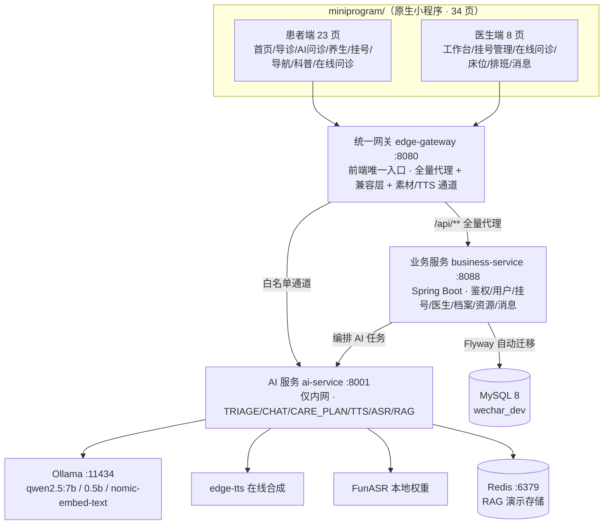

# 项目介绍文档 —— 医疗健康 AI 微信小程序（康诊云 / 小安）

| 项 | 内容 |
|---|---|
| 文档日期 | 2026-10-25 |
| 项目代号 | 康诊云（患者端 AI 助手「小安」） |
| 当前版本 | V1.19（AI 问诊已接真实后端模型；在线问诊双向实时；资源库/附件签名/安全基线就绪） |
| 形态 | 原生微信小程序（WXML + WXSS + JS） + 统一网关 + 业务服务 + AI 服务 |
| 目标读者 | 干系人 / 开发团队 / 测试 / 接管者 |
| 配套文档 | `后端迁移适配文档_20261025.md`（怎么跑起来）、`交接文档_20261025.md`（工作交接） |

---

## 一、项目定位

> **面向中老年及视觉辅助用户的 AI 语音医疗服务入口** —— 「让老人少看字、少输入、少操作，通过说话即可完成健康服务」。

- **适老化优先**：三档字号（standard / large / xlarge）、高对比色、≥88rpx 触控目标、语音播报、防误触、错误可恢复。
- **患者 + 医生双端一体**：登录页双身份入口，患者端 TabBar 与医生端工作台自动分流。
- **AI 贯穿就诊全流程**：智能导诊 → 挂号 → 院内导航 → AI 问诊 → 在线问诊 → 健康科普 → 音色管理。
- **已下线（勿碰）**：手势识别、Live2D 数字人（2026-09-13 前端删除，后端/素材仅作备份）。

---

## 二、总体架构

**一句话架构**：小程序前端只认统一网关（:8080）；网关全量代理到 Spring Boot 业务服务（:8088）；业务服务编排 AI 任务到 FastAPI AI 服务（:8001，仅内网）；数据权威在 MySQL（Flyway 自动迁移），Redis/Ollama/FunASR/edge-tts 为可降级依赖。

**关键设计（契约）**：

| 设计 | 内容 |
|---|---|
| 统一网关单入口 | 前端代码禁止出现 8001/8088/127.0.0.1/localhost；只维护 `env.js` 的 `gateway` 一个地址 |
| 响应信封 | 业务 `{code,msg,data}` / AI `{code,message,data}`；code=200 成功，前端 `request.js` 自动脱壳 |
| 超时三档 | ai 90s / tts 120s / carePlan 180s（网关代理读超时 220s 兜底） |
| 资源库 | 图片/图标按 key 存 `resource_asset` 表（只存元数据，不存 BLOB），流式返回 + ETag/304；219 个图标 + 3 个视频走包内本地 |
| 附件签名 | 健康档案附件私密通道：`expires+sig` 判定顺序 400/410/403/404/200 |
| 院内知识库注入 | 静态版本化 JSON 按场景追加进 system prompt（追加不替换），非 RAG |
| 降级纪律 | dev 档后端不可用 → 只读 mock 兜底；生产档 → 错误态 + 重试，绝不混入伪造数据 |

---

## 三、前端功能（原生微信小程序，34 页 = 31 主包 + 3 分包）

### 3.1 患者端（23 页，TabBar：首页 / AI问诊 / 预约挂号 / 我的）

| 功能 | 页面 | 说明 |
|---|---|---|
| 登录 | 4 页（主登录/患者/医生/手输） | 双身份入口；登录态本地持久化 72h，冷启动跳过登录页；医生走 username 登录 |
| 首页 | home | hero 问候 + 四宫格（智能问诊/预约挂号/AI养生/报告查询）+ 导诊 banner + 8 宫格常用服务 + 健康提示横滑卡 + 科普入口；横屏双栏 |
| 智能导诊 | triage / result | **说完症状直接出科室**（本地规则引擎优先 + 后端 AI 融合）；红旗症状 → 本地优先弹窗 + 一键 120 + 主推荐切急诊科；结果卡附科室依据/分级/挂号入口 + 路线询问（「要」→ 直达导航页） |
| AI 问诊（Tab） | consultation | **已接真实后端模型（2026-10-24）**：多轮信息收集（CHAT 任务，带上下文）→ 达标出科室 + 置信度（TRIAGE 任务）；置信度 ≥0.7 且非兜底科室才出分诊卡；首屏 4 个可点症状示例；打字机输出；隐私开关「仅本地分析」 |
| AI 养生（Tab） | health | 面向年龄段的膳食/睡眠/运动建议（CARE_PLAN 任务，real model） |
| 预约挂号 | appointment | 分步状态机 dept→doctor→time→confirm→done；本地生成预约号 |
| 在线问诊（患者） | consult | 与医生实时对话（会话 ACTIVE 状态机）；4s 内显示「正在接诊」；医生结束 → 只读终态；语音输入/键盘自适应 |
| 院内导航 | packageNav/nav（分包） | 1F 平面图 canvas 同层渲染，起点=医院大门，14 个目的地；**两级带路**：1F 房间直达，2F~4F 先到电梯厅 + 换层提示；自研 pan/pinch；语音播报 |
| 健康科普 | packageContent/knowledge + detail（分包） | 6 篇图文 + 3 个提示视频（随包发布，非后端数据）；分类 × 类型双筛选；平板两列 |
| 音色管理 | voice-settings | 列表/试听/设默认（后端持久化）/重扫；问诊/导诊播报音色 |
| 我的 | profile + 9 个子页 | 挂号记录、健康档案、我的问诊、家庭成员、个人信息（头像/姓名/实名/医保绑定）、设置（三档字号/主题/清除缓存）、音色、隐私政策、用户协议 |
| 其他 | tv/cast 投屏 | 设备连接写本地（模拟） |

### 3.2 医生端（8 页，深海青主题，鉴权拦截）

| 功能 | 页面 | 说明 |
|---|---|---|
| 工作台 | doctor/workbench | 今日概览（summary 四字段：待接诊/正在接诊/预约/消息） |
| 在线问诊 | doctor/consult | **接诊 → 回复 → 结束**全流程：接诊写系统提示、患者 4s 内可见；「结束问诊」二次确认（幂等键防重），结束即终态（患者端只读）；消息实时轮询 |
| 挂号管理 | doctor/appointments | 预约列表（分页）+ 叫号（待就诊→就诊中）+ 完成就诊（→已完成） |
| 床位管理 | doctor/beds | 床位分配/更新（演示占位级） |
| 排班 | doctor/schedule | 排班与在线状态（V22 落地，4 端点） |
| 消息中心 | doctor/messages | 系统通知（医生接诊/结束等事件） |
| 个人设置 / 账号安全 | doctor/personal / account-security | 个人信息、密码/安全项 |

### 3.3 适老化与多端规范

- **字号三档**：standard 36/30/26/22 → large 44/36/32/26 → xlarge 52/42/38/30（rpx）；`settings` 切换 + 登录页大字入口。
- **高对比**：正文对比度 ≥4.5:1；状态不只靠颜色（图标 + 文字）。
- **触控**：关键操作按钮 ≥88rpx。
- **平板适配**：横屏（≥900px 且 ≥700px）双栏 `.page-shell`；竖屏回落 720px 单列；导航页满宽 1180px 用满。
- **视觉系统**：主蓝 `#0B6EF8`（唯一色源 = `app.wxss` 的 page 令牌块），图标只用 `utils/icons.js`（219 键，PNG，禁止 emoji）。
- **主包体积红线**：主包约 1.86MB / 上限 2MB → 视频、大图、内容一律进分包（packageNav / packageContent 有 preloadRule 预下载）。

---

## 四、后端能力（三大服务）

### 4.1 业务服务 business-service（Spring Boot 3.5.x / JDK 17 / :8088）

**八大能力域（2026-10-24 全就绪）：**

| 域 | 关键端点 | 说明 |
|---|---|---|
| 登录鉴权（auth） | `/api/v1/auth/wechat/login`、`refresh`、`logout` | 微信 code2session + 手机号绑定；refresh 一次一换；库内只存 SHA-256 |
| 用户（me） | `/api/v1/me`、`/me/profile` | 当前用户 / 档案更新（乐观锁） |
| 科室医生（catalog） | `/api/v1/departments`、`/departments/{id}/doctors`、`/doctors/{id}/slots` | 科室目录 16 个（2026-10-24 对齐导诊白名单）；号源（UTC Instant） |
| 挂号（appointment） | `POST /api/v1/appointments`、`/cancel`、`/me`、`/stats`、`by-idempotency-key` | Idempotency-Key 必填；原子扣减（SLOT_FULL）；状态机 PENDING→…→终态 |
| 健康档案/家庭（patient） | `/api/v1/health-records`、`/family-members`、`invitations` | CRUD + 代操作授权（GRANTED 才放行，否则 404 不泄露存在性） |
| 首页（home） | `GET /api/v1/home/summary` | greeting + blocks（待就诊预约等） |
| 导诊（triage） | `/api/v1/triage`、`/emergency-checks`、`/recommendations` | 本地红旗规则（TRIAGE-RULES-001）+ AI 融合 |
| 资源库（resources） | `GET /api/v1/resources/{key}`、`/manifest` | 元数据表驱动，匿名只读，ETag/304 |
| 在线问诊（consultations） | `POST /api/v1/consultations`、`/messages`、`/{id}/triage`、`/api/v1/doctor/consultations/{id}/close` | 会话状态机 ACTIVE/CLOSED；AI 回复物化落库；医生接诊/结束（幂等键） |
| 医生端（doctor） | `/api/v1/doctor/login`、`/workbench`、`/appointments`、`/beds`、`/schedule` | 医生登录字段是 **username**；排班与在线状态 |
| 音色（voice） | `/api/gw/voices`（网关别名）、`/api/v1/voice/voices/default`、`/preview`、`/tts` | 列表/设默认/试听/TTS 合成（multipart） |
| 消息中心/审计/安全 | 医生消息、`audit_events` 表、注销 30 天物理清除定时任务 | 写操作全审计；账号注销物理清理 |

**安全基线（2026-10-23 四模块优化）**：legacy 登录/CORS 生产关闭；AI 鉴权 static + 强 token fail-fast；附件签名密钥 fail-fast；医生列表 SQL 越权修复（VIEW_SELECT WHERE 锚点）；东八区 keyset 时区错位修复；日志脱敏（手机号/身份证/邮箱/Bearer 值落盘前掩码）。

### 4.2 AI 服务 ai-service（FastAPI / :8001 / 仅内网）

**任务类型（提交→轮询唯一交互）：**

| 任务 | 能力 | 模型/引擎 | 结果形状 |
|---|---|---|---|
| TRIAGE | 导诊科室推荐（补充档） | qwen2.5:7b（CPU 实测 12~25s） | `recommendedDepartments[{departmentName,reason,confidence}]` |
| CHAT | 问诊多轮对话 | qwen2.5:7b | `{text, citations, refused…}` |
| CARE_PLAN | 养生/照护建议 | qwen2.5:7b | `suggestions[]`（上限 5 条，恒含「不构成处方」limitations） |
| TTS | 语音合成 | edge-tts（在线） | `{audioUrl, language}`（短期签名 URL） |
| ASR | 语音识别 | FunASR 本地权重 | `{transcript, language}`（草稿，须用户确认） |
| RAG | 知识检索 | Redis 演示存储 + nomic-embed-text | `documents[]`（开关控制，当前 true/redis） |

**AI 性能开关（2026-10-22 起开启，配置在 env.local）：**

| 开关 | 现值 | 效果（实测） |
|---|---|---|
| `AI_CACHE_ENABLED` | true | 内容寻址缓存（HMAC 键含 tenant/input/模型/知识库版本），命中 97.1ms vs 未命中 8488.8ms；命中率 80% |
| `AI_ASR_PRELOAD` | true | 启动后台预热 FunASR（CPU 加载约 27s，不阻塞）；首请求 27.9s→0.76s |
| `AI_RAG_ENABLED` | true（redis 演示） | Redis 存向量 + 服务端余弦 top-k（KB < 200 条毫秒级）；生产备选 Qdrant（runbook 见 docs/运维/） |
| `AI_LLM_STREAM` / `AI_LLM_WORKER_POOL_SIZE` | true / 3 | 内部流式累积 + worker 池并发；压测 QPS 1.05→4.82（x4.6）、P95 28320ms→6159ms；失败自动回退 |
| `AI_TRIAGE_TIMEOUT_SECONDS` | 180 | 7B CPU 上单轮 30~90s 不超时；上 GPU 后调回 60 |
| 院内知识库 | v3 | 四场景（triage 300 / chat 400 / careplan 300 / interpret 400 tokens）追加注入 system prompt；改内容须 bump version + 跑门禁 |

**降级矩阵**：ollama 缺失 → 导诊走本地规则引擎兜底（红旗本地优先）、问诊/养生如实报不可用；edge-tts 需外网；FunASR 权重缺失 → ASR 不可用（不伪造转写）；RAG 存储不可达 → 空 citations。**全部「能力如实返回」**（engine=none/funasr/edge，不含糊）。

### 4.3 统一网关 edge-gateway（FastAPI / :8080）

- 路由：`/api/gw/**` 网关自身；其余 `/api/**` **全量代理** business-service（不再按旧白名单分流）；legacy 旧路径经兼容层翻译（`COMPAT.md`）。
- 公开通道：`/api/gw/tts/audio/{filename}`（TTS 产物，白名单 `^[0-9a-f]{16,64}\.mp3$`）、`/api/gw/assets/{filename}`（静态素材，ETag/304 + sha256）。
- 健康探针：`/api/gw/health` 三上游聚合（java/python/ollama），任一不可达 → `degraded`。
- 错误信封统一：`code/message/requestId/retryable/serverTime`；上游 503→`UPSTREAM_UNAVAILABLE`、504→`UPSTREAM_TIMEOUT` 等。
- SSE 流式透传（`/api/v1/ai/tasks/{id}/events` 不被缓冲，断线回轮询）；限流（默认关）；日志脱敏。

---

## 五、技术栈与约束

| 项 | 内容 |
|---|---|
| 前端 | 原生 WXML/WXSS/JS，**禁止 Vue/React/UniApp**；`services/` 统一契约层；`utils/` 知识库/图标/错误文案 |
| 后端 | FastAPI（网关/AI）+ Spring Boot 3.5.x（业务）；契约事实源 `backend/contracts/*.yaml` |
| 数据库 | MySQL 8 + Flyway（迁移 + dev 种子）；Redis（RAG 演示）；Qdrant（生产备选） |
| 大模型 | Ollama：qwen2.5:7b（主）/ qwen2.5:0.5b / nomic-embed-text |
| 语音 | TTS=edge-tts（流式合成 + 本地产物缓存 + 短期签名）；ASR=FunASR（本地权重）；曾接 Qwen3-TTS(WAV)（`/tts/edge` 兼容别名保留） |
| 部署 | `backend/deploy/` 一键启动（bat + PowerShell 编排器 + GUI 面板）；生产走 HTTPS + 备案 + 小程序合法域名 |

**平台红线（开发约定摘要）**：页面数据一律走 `services/`（禁止散写业务数据）；状态禁止只用颜色表达；动画只动 opacity；错误文案只走 `utils/err-text.js`；禁止 emoji 作图标；分包资源不被主包引用；宽屏断点 rpx→px。

---

## 六、部署形态

| 档位 | 网关地址（env.js BUILD_ENV） | 说明 |
|---|---|---|
| local | `http://127.0.0.1:8080`（DEV_DIRECT） | PC 模拟器直连本机；后端不可用时只读 mock 兜底 |
| development | `https://qv56gv32944.vicp.fun` | 隧道联调（真机）；三类合法域名需填该域名；**真机验证必须用本档**（local 档真机会连手机自己） |
| production | 正式 HTTPS（必须 备案 + 小程序后台合法域名 + `mockReadFallback=false`） | 发布流水线替换；暂未配置（体验版/正式版受阻：穿透域名未备案） |

启动方式见《后端迁移适配文档》：`backend\deploy\start-all.bat -Setup -Yes -Smoke`（一键全套），`status.bat` 查状态，`start-gui.bat` 图形面板。

---

## 七、相关文档索引

| 文档 | 用途 |
|---|---|
| `AI_CONTEXT.md` | AI Agent 快速上下文（版本/契约/红线/验证脚本，保持最短） |
| `后端迁移适配文档_20261025.md` | 本仓库怎么在新机器跑起来（含 AI 快速启动向导） |
| `交接文档_20261025.md` | 近期工作内容交接 + 未完成事项 |
| `docs/后端接入指南_20261021.md` | 前端/联调/部署接口说明 |
| `docs/后端接入文档_20261021_V21.md` | 八项能力落地单 + DB 结构（36 表 DDL） |
| `docs/AI性能事实复核_20261022.md` | AI 性能项唯一事实表（先看复核再动手） |
| `docs/资源库分类规则_20261019.md` | 资源库 delivery 分类规则 |
| `docs/运维/Qdrant与RAG生产上线runbook.md` | RAG 生产部署手册 |
| `backend/deploy/README.md` | 一键启动行为与排障表 |
